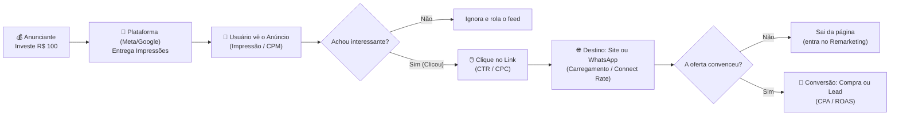

# Etapa 01.1 — O que é Tráfego Pago e a Tríade da Venda Online

## 1. O Conceito de Tráfego (A Analogia da Loja Física)

Imagine que você abriu a melhor hamburgueria da sua cidade. O pão é artesanal, a carne é perfeita e o preço é justo. Porém, você abriu essa loja **no final de uma rua sem saída, no meio de um deserto**. Quantos hambúrgueres você vai vender? **Zero.**

No mundo digital, **Tráfego é o fluxo de pessoas** passando na frente da sua vitrine (seu site, seu WhatsApp, seu perfil do Instagram).

```
+-----------------------------------------------------------------------+
|                       RUA MOVIMENTADA (INTERNET)                      |
|  🚶 🏃 🚶‍♀️ 🏃‍♂️ 🚶 🏃 🚶‍♀️  ---> [ PLACA / ANÚNCIO ]                       |
|                                     |                                 |
|                                     v (Clique)                        |
|                        +-------------------------+                    |
|                        |   SUA LOJA / SITE / LP  |                    |
|                        |    🍔 Oferta Irresistível|                    |
|                        +-------------------------+                    |
|                                     |                                 |
|                                     v                                 |
|                              💰 VENDA / LEAD                          |
+-----------------------------------------------------------------------+
```

Existem duas formas de colocar pessoas dentro da sua loja digital:

| Característica | 🌱 Tráfego Orgânico | 🚀 Tráfego Pago |
| :--- | :--- | :--- |
| **Moeda de troca** | Seu **Tempo** (criação de conteúdo, SEO) | Seu **Dinheiro** (compra de espaço publicitário) |
| **Velocidade** | Lento (meses para maturar) | Imediato (subiu a campanha, pessoas chegam hoje) |
| **Previsibilidade** | Baixa (depende do humor do algoritmo) | Alta (você controla quanto investe e quem vê) |
| **Escala** | Limitada pela sua capacidade de postar | Ilimitada (se R$ 100 voltam R$ 300, você pode pôr R$ 1.000) |
| **Quando parar?** | Continua gerando visitas residuais | Parou de pagar, o fluxo cessa imediatamente |

> **Regra de Ouro:** O Tráfego Pago **não faz milagre** em produto ruim, atendimento demorado ou site lento. Ele apenas **acelera** o que já aconteceria no orgânico. Se sua loja converte bem, o tráfego multiplica as vendas; se sua loja é ruim, o tráfego só faz você descobrir isso mais rápido.

---

## 2. A Tríade da Conversão Online (Por que só o anúncio não vende?)

Muitos iniciantes acham que "fazer tráfego" é apenas apertar botões no Gerenciador de Anúncios. Na realidade, uma venda online depende de **3 pilares interdependentes**:

```
                  +---------------------------+
                  |        1. TRÁFEGO         |
                  |  (Anúncio + Público Certo)|
                  +-------------+-------------+
                                |
                   Qualifica e  |  Atrai o clique
                   envia para   v
        +-----------------------+-----------------------+
        |                                               |
+-------+-------------------+               +-----------+---------------+
|         2. OFERTA         |               |        3. DESTINO         |
|  (Produto, Preço, Bônus,  | <===========> | (Landing Page, E-commerce,|
|   Garantia, Promessa)     |   Apresenta   |  Atendimento no WhatsApp) |
+---------------------------+               +---------------------------+
```

### Como identificar qual pilar está falhando? (Exemplo Prático)

Imagine que você está anunciando uma **Clínica Odontológica (Implante Dentário)**:

* **Cenário A (Erro no Tráfego):** Seu anúncio aparece para adolescentes de 18 anos que gostam de videogame. Ninguém clica. *(Solução: Ajustar segmentação e criativo no Gerenciador).*
* **Cenário B (Erro no Destino):** Seu anúncio é ótimo, pessoas de 50+ anos clicam para falar no WhatsApp, mas a secretária demora **4 horas para responder** "Oi, tudo bem?". O cliente esfria e vai no concorrente. *(Solução: Treinar comercial / melhorar página).*
* **Cenário C (Erro na Oferta):** O anúncio atrai o público certo, a página carrega rápido, mas você cobra R$ 15.000 à vista sem parcelamento e sem mostrar nenhum depoimento ou autoridade do dentista. *(Solução: Melhorar condições, prova social e percepção de valor).*

---

## 3. O Fluxo Completo do Usuário no Tráfego Pago

Veja no fluxograma abaixo o caminho exato que o dinheiro e o usuário percorrem desde o momento em que você ativa uma campanha:



---

## 4. Os 4 Modelos deObjetivo de Negócio no Tráfego

Antes de abrir qualquer ferramenta, você precisa saber **qual é o modelo de conversão** do negócio que você está anunciando:

1. **Tráfego para WhatsApp / Direct (Negócios Locais e Serviços):**
   * *Exemplos:* Clínicas, advogados, estética, delivery, imobiliárias, oficinas.
   * *Objetivo do anúncio:* Fazer a pessoa iniciar uma conversa qualificada. Quem fecha a venda é o humano (ou bot) no atendimento.
2. **Geração de Leads / Cadastro (B2B, Lançamentos, Alto Ticket):**
   * *Exemplos:* Seguros, softwares (SaaS), faculdades, consórcios, infoprodutos em lançamento.
   * *Objetivo do anúncio:* Capturar Nome, E-mail e Telefone em uma Landing Page ou Formulário Nativo.
3. **Venda Direta / E-commerce (Self-Service):**
   * *Exemplos:* Lojas virtuais (Shopify, Nuvemshop), cursos perpétuos (Hotmart, Kiwify).
   * *Objetivo do anúncio:* A pessoa clica, entra na página, coloca o cartão de crédito ou Pix e compra sozinha, sem falar com ninguém.
4. **Branding e Crescimento de Audiência (Autoridade / Conteúdo):**
   * *Exemplos:* Médicos, influenciadores, grandes marcas locais.
   * *Objetivo do anúncio:* Distribuir vídeos de conteúdo útil e trazer seguidores qualificados para o perfil.
