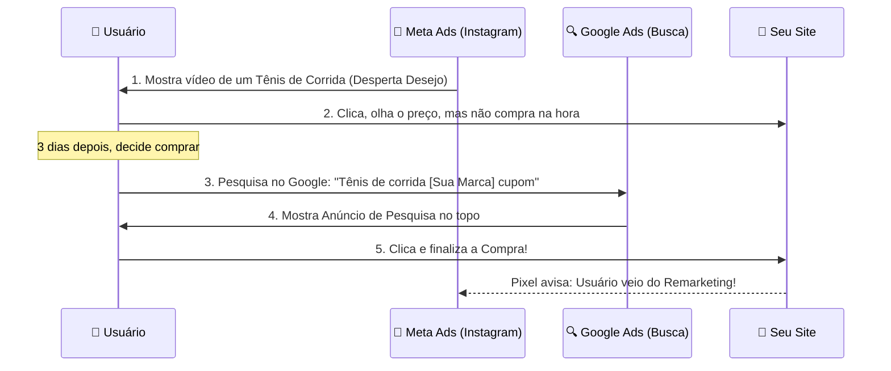

# Etapa 01.2 — O Ecossistema das Plataformas e a Lógica do Leilão

## 1. Atenção vs. Intenção: O Conceito Mais Importante do Tráfego

Todas as plataformas de anúncios da internet se dividem em **dois grandes grupos psicológicos**. Entender essa diferença evita que você anuncie o produto errado na rede errada:

```
+-----------------------------------+-----------------------------------+
|      📱 REDES DE ATENÇÃO          |      🔍 REDES DE INTENÇÃO         |
|  (Meta Ads, TikTok Ads, Kwai)     |  (Google Pesquisa, Shopping, Bing)|
+-----------------------------------+-----------------------------------+
| O usuário NÃO entrou para comprar.| O usuário ESTÁ procurando comprar.|
| Ele entrou para ver memes, fotos  | Ele digitou ativamente a dor ou   |
| de amigos, fofocas e vídeos.      | o produto na barra de busca.      |
|                                   |                                   |
| -> Você INTERROMPE a navegação.   | -> Você RESPONDE a uma pergunta.  |
| -> Cria desejo onde não havia.    | -> Captura demanda já existente.  |
+-----------------------------------+-----------------------------------+
```

### Exemplo Prático: O Desentupidor vs. A Roupa Nova

* **Caso 1 (Urgência / Dor Aguda — "Chaveiro 24h" ou "Desentupidora"):**
  Ninguém está rolando o Instagram domingo à noite e pensa: *"Nossa, que vídeo bonito de desentupidora, vou contratar!"*. Quando o cano estoura, a pessoa corre para o **Google** e digita: `desentupidora urgente perto de mim`. Aqui, **Intenção (Google Search)** reina absoluta.
* **Caso 2 (Desejo / Descoberta — "Vestido de Festa" ou "Curso de Inglês"):**
  A pessoa não acordou pensando em comprar aquele vestido específico. Mas enquanto rolava os Stories do **Instagram**, viu um vídeo incrível com caimento perfeito e frete grátis. O desejo nasceu na hora. Aqui, **Atenção (Meta Ads / TikTok)** é uma máquina de vendas.

### Como as duas trabalham juntas? (O Efeito Pingue-Pongue)



---

## 2. Como Funciona o Leilão das Plataformas?

Muita gente acha que no Tráfego Pago **quem tem mais dinheiro sempre ganha o primeiro lugar**. **Isso é MENTIRA.**

Se a Meta (Facebook/Instagram) ou o Google mostrassem apenas os anúncios das empresas mais ricas, mas esses anúncios fossem chatos, enganosos ou irrelevantes, **os usuários abandonariam a rede social**. E sem usuários, a plataforma morre.

Por isso, o leilão equilibra **Dinheiro (Lance)** + **Qualidade do Anúncio (Experiência do Usuário)**.

### A Fórmula Mental do Leilão

```
+-------------------------------------------------------------------------+
|  PONTUAÇÃO TOTAL = (Quanto você paga) x (Probabilidade de Ação)         |
|   NO LEILÃO         [Lance / Bid]        [CTR estimado + Conversão]     |
|                                        + (Qualidade do Anúncio e Página)|
+-------------------------------------------------------------------------+
```

### Exemplo Real de Leilão (Quem ganha?)

Imagine dois concorrentes disputando o mesmo espaço na tela do seu celular:

| Critério | 🏢 Anunciante A (Rico, Anúncio Ruim) | 🚀 Anunciante B (Você, Anúncio Excelente) |
| :--- | :---: | :---: |
| **Lance Máximo (Quanto aceita pagar)** | R$ 5,00 | **R$ 3,00** |
| **Qualidade do Criativo (Relevância/CTR)** | Nota 2 / 10 (Ninguém clica) | **Nota 9 / 10 (Todo mundo engaja)** |
| **Velocidade e Qualidade da Página** | Nota 3 / 10 (Demora 8s para abrir) | **Nota 9 / 10 (Abre em 1,5s)** |
| **Pontuação Final no Algoritmo** | `5 x (2 + 3) = 25 pontos` | **`3 x (9 + 9) = 54 pontos`** |
| **Resultado no Leilão** | ❌ Perde espaço e paga caro | 🏆 **Vence o leilão pagando MENOS!** |

> **Lição Prática:** Um criativo excelente (bom gancho, boa promessa) e uma página rápida são a forma mais inteligente de **reduzir o seu custo por clique (CPC) pela metade** sem precisar aumentar a verba.

---

## 3. Panorama das Principais Plataformas de Tráfego Pago

| Plataforma | Melhor Para... | Formato Principal | Perfil de Público |
| :--- | :--- | :--- | :--- |
| **Meta Ads** *(Facebook + Instagram)* | E-commerce, Infoprodutos, Negócios Locais, Geração de Leads, WhatsApp | Vídeos curtos (Reels/Stories), Carrossel, Imagem estática | Praticamente toda a população conectada (18 a 65+ anos) |
| **Google Ads** *(Search + Shopping)* | Prestadores de serviço urgente, E-commerce (fundo de funil), SaaS, B2B | Texto na busca, Catálogo de produtos com preço e foto | Pessoas com intenção imediata de solução ou compra |
| **YouTube Ads** *(via Google Ads)* | Produtos que exigem explicação profunda, Lançamentos, Branding | Vídeos horizontais (In-Stream puláveis) e Shorts | Consumidores de conteúdo denso, tutoriais e entretenimento |
| **TikTok Ads** | Moda, Beleza, Apps, Produtos virais/impulso, Público jovem | Vídeos verticais nativos com cara de conteúdo orgânico (UGC) | Forte presença entre 16 e 38 anos, altíssimo tempo de tela |
| **LinkedIn Ads** | Vendas B2B (empresa para empresa), Softwares corporativos, Recrutamento | Imagem, Documento PDF, Mensagem direta (InMail) | Diretores, Gerentes, RH, Compradores corporativos (CPC mais alto) |
| **Pinterest Ads** | Decoração, Arquitetura, Casamento, Moda, Receitas, Artesanato | Imagens verticais inspiracionais (Pins) | Público planejador (majoritariamente feminino com alta intenção de compra futura) |
