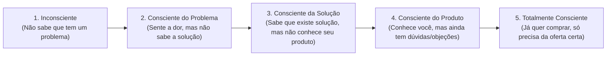

# Etapa 02.1 — O Funil de Vendas e os 5 Níveis de Consciência

## 1. Por que Anunciar "Compre Agora" para Desconhecidos Quase Sempre Dá Errado?

Imagine abordar uma pessoa desconhecida na rua e dizer: *"Casa comigo agora?"*. Ela vai correr de você. No tráfego pago, mostrar um anúncio de *"Compre minha consultoria de R$ 2.000"* para alguém que nunca ouviu falar de você produz a mesma reação.

Para transformar estranhos em clientes fiéis, estruturamos as campanhas em um **Funil de Tráfego**.

### Desenho Visual do Funil de Tráfego Pago

```
\=====================================================================/
 \                 TOPO DE FUNIL (ToFu) - PÚBLICO FRIO               /
  \     Pessoas que NÃO te conhecem. Objetivo: Atrair atenção,      /
   \    despertar curiosidade, tocar na dor ou desejo principal.   /
    \       [Formatos: Reels virais, Vídeos de dica, Busca ampla] /
     \-----------------------------------------------------------/
      \            MEIO DE FUNIL (MoFu) - PÚBLICO MORNO         /
       \   Pessoas que já visitaram seu perfil, viram 50% de   /
        \  um vídeo ou entraram no site. Objetivo: Quebrar    /
         \ objeções, gerar autoridade e capturar contato.    /
          \  [Formatos: Depoimentos, Bastidores, Estudos]   /
           \-----------------------------------------------/
            \      FUNDO DE FUNIL (BoFu) - PÚBLICO QUENTE /
             \  Abandonou carrinho, iniciou checkout ou  /
              \ pesquisou o nome da sua marca.          /
               \ Objetivo: Oferta direta, Escassez,    /
                \ Cupom, Garantia para fechar venda!  /
                 \===================================/
                                  ||
                                  vv
                           💰 CLIENTE NOVO
```

---

## 2. Os 5 Níveis de Consciência (Eugene Schwartz)

Criado pelo lendário copywriter Eugene Schwartz no livro *Breakthrough Advertising*, esse conceito define **como você deve escrever o seu anúncio** dependendo do que passa na cabeça do cliente:



### Exemplos Práticos de Anúncios para Cada Nível (Exemplo: Colchão Terapêutico)

| Nível de Consciência | O que o cliente pensa? | Como deve ser a frase inicial (Gancho) do seu Anúncio? | Onde anunciar? |
| :--- | :--- | :--- | :--- |
| **1. Inconsciente** | *"Sou meio irritado e sem energia à tarde, deve ser a idade."* | *"3 sinais silenciosos de que a posição da sua coluna à noite está roubando 40% da sua energia durante o dia."* | Meta Ads / TikTok (Público Aberto) |
| **2. Consciente do Problema** | *"Acordo todo dia com dor lombar horrível."* | *"Acordar com dor nas costas não é normal. Veja como alinhar a lombar sem remédios."* | Meta Ads (Interesses) / Google (`dor nas costas ao acordar`) |
| **3. Consciente da Solução** | *"Preciso trocar meu colchão por um ortopédico de densidade progressiva."* | *"Por que colchões ortopédicos comuns afundam em 6 meses (e qual tecnologia evita isso)."* | Google Search (`melhor colchao ortopedico`) / Meta Ads |
| **4. Consciente do Produto** | *"Vi o Colchão OrthoMax, parece bom, mas será que vale R$ 3.500?"* | *"Veja o que aconteceu com a coluna do João após 30 noites no OrthoMax + 100 dias de teste grátis em casa."* | Remarketing Meta/YouTube (Quem visitou o site) |
| **5. Totalmente Consciente** | *"Vou comprar o OrthoMax hoje, deixa eu ver se tem desconto."* | *"Últimas 24h: Colchão OrthoMax com R$ 500 OFF + 2 Travesseiros de Brinde e Frete Grátis."* | Remarketing de Carrinho (7 dias) + Google (`colchao orthomax comprar`) |

---

## 3. Como Distribuir a Verba Entre as Etapas do Funil?

Uma dúvida clássica: *"Tenho R$ 1.500 por mês. Quanto coloco em Público Frio e quanto em Remarketing?"*

Depende do estágio da sua conta:

```
+-----------------------------------------------------------------------+
| FASE 1: CONTA NOVA (Mês 1) - Você ainda não tem audiência acumulada   |
| [======================== 90% PÚBLICO FRIO ========================][10%]
|                                                                  Remarketing
+-----------------------------------------------------------------------+
| FASE 2: CONTA EM TRAÇÃO (Mês 2 a 4) - Já tem visitas e engajamento    |
| [=================== 75% PÚBLICO FRIO ===================][ 25% RMKT ]|
+-----------------------------------------------------------------------+
| FASE 3: CONTA MADURA / LANÇAMENTO (Grande base aquecida)              |
| [=============== 60% a 70% FRIO ===============][ 30% a 40% RMKT/BASE ]
+-----------------------------------------------------------------------+
```

> **Por que nunca colocar 50% em Remarketing em uma conta pequena?**
> Se você gasta apenas R$ 20/dia no Público Frio, apenas ~40 pessoas entram no seu site por dia. Se você tentar gastar R$ 20/dia só para perseguir essas 40 pessoas no Remarketing, elas verão o seu anúncio **15 vezes no mesmo dia** (Frequência altíssima), ficarão irritadas, ocultarão seu anúncio e seu dinheiro será jogado no lixo.
