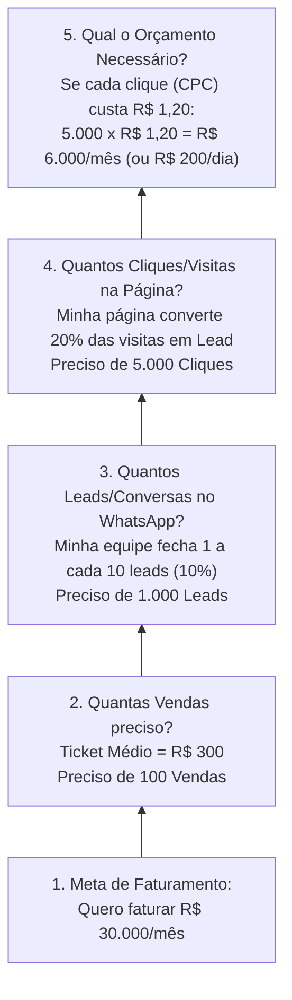

# Etapa 02.2 — Planejamento Financeiro, Engenharia Reversa e CPA Máximo

## 1. A Regra Número 1 antes de Subir Campanha: Quanto Você Pode Pagar por Venda?

Se um gestor de tráfego pergunta ao cliente *"Qual é a sua meta?"* e a resposta é *"Vender o máximo possível gastando o mínimo possível"*, **essa campanha já começou errada**.

Você precisa saber exatamente qual é o seu **CPA Máximo (Custo por Aquisição Máximo)** — ou seja, até quantos reais você pode gastar em anúncios para realizar **1 venda** sem ter prejuízo.

### A Anatomia do Preço de um Produto (Desenho Visual)

Imagine um produto vendido por **R$ 200,00**:

```
+-----------------------------------------------------------------------+
|                     PREÇO DE VENDA: R$ 200,00 (100%)                  |
+-----------------------+-----------------------+-----------------------+
|   CUSTOS VARIÁVEIS    |  CPA MÁXIMO (EMPATE)  |     LUCRO LÍQUIDO     |
|      R$ 80,00         |    Até R$ 120,00      |  Tudo que sobrar abaixo|
| (Produto, Imposto,    | (Margem de Contrib.)  |  dos R$ 120 de CPA!   |
|  Taxa Cartão, Frete)  |                       |                       |
+-----------------------+-----------------------+-----------------------+
```

### Fórmulas Fundamentais

1. **Margem de Contribuição ($MC$) = CPA de Empate (Break-even):**
   $$MC = \text{Preço de Venda} - (\text{Custo do Produto} + \text{Impostos} + \text{Taxas de Checkout/Frete})$$
   *No exemplo acima:* $200 - 80 = \text{R\$ } 120,00$.
   * O que isso significa? Se você gastar **R$ 120,00** em anúncios para fazer 1 venda de R$ 200, você **empatou (0 a 0)**.

2. **CPA Ideal (Com Lucro Desejado):**
   Se você quer ter **R$ 60,00 de lucro líquido** no bolso a cada venda:
   $$\text{CPA Ideal} = MC - \text{Lucro Desejado} = 120 - 60 = \text{R\$ } 60,00$$

3. **ROAS Mínimo (Retorno sobre Investimento Publicitário de Empate):**
   $$\text{ROAS de Empate} = \frac{\text{Preço de Venda}}{\text{CPA de Empate}} = \frac{200}{120} = 1,67$$
   * E para o **ROAS Ideal** (com CPA de R$ 60):
   $$\text{ROAS Ideal} = \frac{200}{60} = 3,33$$
   *(Ou seja, a cada R$ 1,00 colocado em anúncios, precisam voltar R$ 3,33 em faturamento bruto).*

---

## 2. Engenharia Reversa do Funil (Como Calcular o Orçamento Necessário)

Como descobrir quanto você precisa investir por mês para atingir uma meta de faturamento? Fazendo o **cálculo de baixo para cima (Engenharia Reversa)**.



### Tabela de Simulação Prática (Negócio Local / WhatsApp vs. E-commerce)

Veja dois exemplos reais de planejamento mensal:

| Métrica do Funil | 🦷 Exemplo 1: Clínica (WhatsApp) | 👕 Exemplo 2: Loja de Roupas (E-commerce) |
| :--- | :---: | :---: |
| **Meta de Faturamento Mensal** | R$ 20.000,00 | R$ 45.000,00 |
| **Ticket Médio por Cliente** | R$ 1.000,00 | R$ 150,00 |
| **Vendas Necessárias** (`Meta / Ticket`) | **20 vendas** | **300 vendas** |
| **Taxa de Fechamento (WhatsApp ou Site)** | 10% dos leads fecham | 1,5% dos visitantes compram |
| **Leads ou Visitas Necessárias** | 200 leads no WhatsApp | 20.000 visitas no site |
| **Custo Estimado (CPL ou CPC)** | R$ 12,00 por conversa (CPL) | R$ 0,45 por visita (CPC) |
| **Orçamento Mensal Necessário** | **R$ 2.400,00 / mês** *(R$ 80/dia)* | **R$ 9.000,00 / mês** *(R$ 300/dia)* |
| **ROAS Esperado** (`Faturamento / Verba`) | **8,33x** | **5,00x** |

---

## 3. Quanto Investir no Começo? (Verba Mínima de Teste)

* **Meta Ads (Facebook/Instagram):** O mínimo técnico por conjunto de anúncios gira em torno de **1 dólar por dia** (~R$ 6,00/dia), mas para ter velocidade de aprendizado recomendam-se pelo menos **R$ 20,00 a R$ 35,00 por dia** (~R$ 600 a R$ 1.000/mês).
* **Google Ads (Rede de Pesquisa):** Depende do preço do clique do seu nicho. Se o clique de `advogado trabalhista` custa R$ 5,00, você precisa de pelo menos **10 cliques por dia** para ter dados estatísticos — logo, **R$ 50,00/dia**. Se o clique do seu nicho custa R$ 1,50, **R$ 15 a R$ 20/dia** já funcionam muito bem.

> **Regra do Orçamento de Teste por Criativo/Conjunto:**
> Nunca desligue um conjunto de anúncios de venda direta antes de ele gastar pelo menos **1x o valor do seu CPA Ideal** (ou 50% do Ticket do produto). Se o seu CPA ideal é R$ 50 e você gastou apenas R$ 12,00 e pausou porque "não vendeu", você matou a campanha antes de o algoritmo sequer começar a trabalhar.
