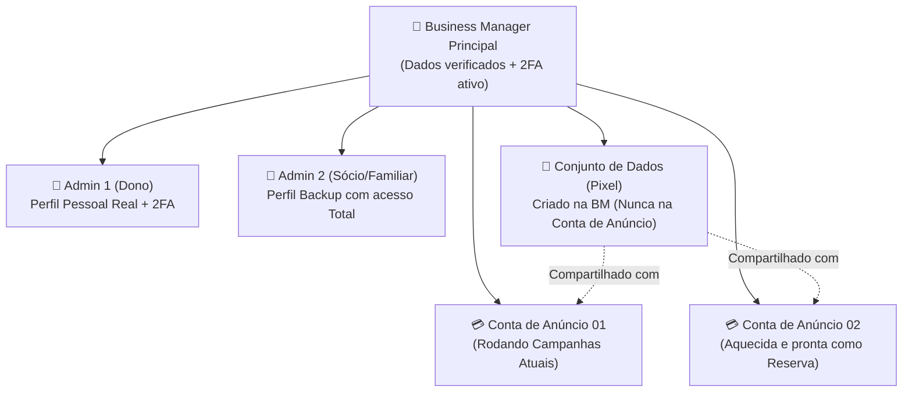

# Etapa 03.1 — Estrutura Profissional, Ativos e Contingência (BM)

## 1. O Erro Fatal do Iniciante: O Botão "Turbinar" vs. Gerenciador de Negócios

Apertar o botão **"Turbinar Publicação"** direto pelo aplicativo do Instagram é como pilotar um avião usando apenas um volante de brinquedo: você não escolhe posicionamentos avançados, não faz exclusão de públicos, não usa a API de Conversões corretamente e ainda **paga 30% de taxa extra para a Apple** se fizer isso pelo iPhone (iOS).

Todo gestor profissional anuncia através do **Gerenciador de Negócios (Business Manager / Meta Business Suite)**: `business.facebook.com`.

### Desenho da Hierarquia do Business Manager (BM)

Pense no **Business Manager (BM)** como um **Cofre Empresarial**. Dentro dele ficam guardados todos os seus ativos:

```
+=======================================================================+
|                🏢 BUSINESS MANAGER (BM / Portfólio Empresarial)        |
|                     (O Cofre da Empresa - CNPJ)                       |
+=======================================================================+
       |                  |                  |                   |
       v                  v                  v                   v
+--------------+  +---------------+  +---------------+  +---------------+
| 👥 PESSOAS   |  | 💳 CONTAS DE  |  | 📱 PÁGINAS E  |  | 🎯 PIXEL /    |
| (Perfis FB)  |  |    ANÚNCIO    |  |    INSTAGRAM  |  | CONJUNTO DADOS|
+--------------+  +---------------+  +---------------+  +---------------+
| - Admin 1    |  | - CA 01 (Ativa|  | - FanPage FB  |  | - Pixel Site  |
| - Admin 2    |  | - CA 02 (Bkp) |  | - @Instagram  |  | - Catálogo    |
| - Gestor     |  | - Cartão/Pix  |  | - WhatsApp Biz|  | - Domínio Ver.|
+--------------+  +---------------+  +---------------+  +---------------+
```

---

## 2. Regras de Ouro de Segurança e Contingência Básica

Bloqueios no Meta Ads e no Google Ads acontecem — muitas vezes por erro de robôs de revisão. Se toda a sua empresa depende de **1 único perfil do Facebook e 1 única conta de anúncios**, seu negócio corre risco de parar da noite para o dia.

### Fluxograma de Blindagem da Estrutura (Contingência)



### Checklist dos 7 Mandamentos Anti-Bloqueio

1. **Autenticação de Dois Fatores (2FA) Obrigatória:** Ative o 2FA via aplicativo (Google Authenticator ou Authy) no seu perfil pessoal do Facebook e exija para todos na BM. Sem isso, a Meta bloqueia o acesso ao gerenciador.
2. **Nunca tenha apenas 1 Administrador na BM:** Se o seu perfil pessoal do Facebook cair ou for hackeado, você perde a BM inteira. Adicione sempre um segundo perfil real (cônjuge, sócio, familiar de confiança) como Administrador com Controle Total.
3. **O Pixel pertence à BM, não à Conta de Anúncios:** Crie o seu Pixel dentro de `Configurações do Negócio > Origens de Dados > Conjuntos de Dados`. Se a **Conta de Anúncio 01** for bloqueada, você simplesmente compartilha o mesmo Pixel com a **Conta de Anúncio 02** e não perde a inteligência acumulada!
4. **Verificação de Domínio:** Verifique o domínio do seu site (`seusite.com.br`) dentro da BM via registro TXT no DNS (Cloudflare, Registro.br, Hostinger).
5. **Meios de Pagamento:**
   * **Cartão de Crédito (Pós-pago):** O melhor método. O titular do cartão deve bater com dados limpos, com limite disponível para evitar falhas de cobrança repetidas (que geram suspensão financeira).
   * **Pix / Boleto (Pré-pago):** Cuidado! Se a conta for desativada com saldo pré-pago lá dentro, o reembolso é extremamente burocrático. Se usar pré-pago, coloque saldo para no máximo 3 a 7 dias por vez.
6. **Cuidado com Promessas Proibidas (Políticas de Publicidade):**
   * ❌ **Antes e Depois agressivo** (ex.: foto de barriga antes/depois para emagrecimento ou dentes amarelos vs. brancos exagerados).
   * ❌ **Promessa de dinheiro fácil / garantido** (*"Ganhe R$ 5.000 em 7 dias sem esforço"*).
   * ❌ **Atributos pessoais diretos** (*"Você está acima do peso e triste?"* -> Troque por: *"Para quem busca recuperar a disposição e o peso ideal..."*).
7. **Aquecimento de Conta Nova:** Não crie uma conta hoje e coloque R$ 1.000/dia em conversão com link externo na primeira hora. Comece com R$ 20 a R$ 50/dia, deixe passar as primeiras cobranças do cartão sem falha e aumente gradualmente.
