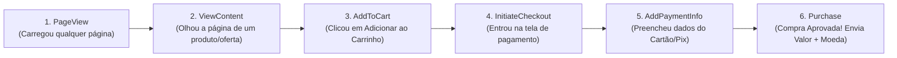

# Etapa 03.2 — Rastreamento Profissional: Pixel, API de Conversões, GTM e UTMs

## 1. O que é o Pixel e a API de Conversões (CAPI)?

Imagine que o seu site é uma loja física às escuras. Pessoas entram, olham produtos, algumas compram e outras vão embora, mas você não sabe quem são nem qual anúncio as trouxe.

O **Pixel (Meta) / Tag (Google)** é uma **câmera inteligente** instalada no seu site que observa cada passo do visitante e avisa a plataforma de anúncios: *"Ei, Meta! A Maria, que clicou no anúncio do Vídeo 02, acabou de comprar um sapato de R$ 250!"*.

### Por que só o Pixel de Navegador (Browser) não basta mais?

Após o iOS 14 da Apple, bloqueadores de anúncio (AdBlock) e restrições de cookies dos navegadores (Safari, Chrome, Brave), cerca de **20% a 35% das conversões são bloqueadas** quando enviadas apenas pelo navegador do usuário.

Para resolver isso, usamos o rastreamento duplo: **Pixel (Navegador) + API de Conversões (Servidor)** com **Desduplicação (`event_id`)**.

```
                    +-------------------------------+
                    |     👤 USUÁRIO NO SEU SITE     |
                    |   (Acabou de Comprar R$ 197)  |
                    +---------------+---------------+
                                    |
             +----------------------+----------------------+
             | (Caminho 1: Browser)                        | (Caminho 2: Server-Side)
             v                                             v
+----------------------------+               +----------------------------+
| 🌐 PIXEL DO NAVEGADOR      |               | 🖥️ SERVIDOR DO SITE / GTM   |
| (Pode ser barrado por iOS  |               | (API de Conversões - CAPI) |
|  ou AdBlock! ID: #ABC123)  |               | (Imune a AdBlock! #ABC123) |
+-------------+--------------+               +--------------+-------------+
              |                                             |
              +----------------------+----------------------+
                                     |
                                     v
                    +-------------------------------+
                    | 🤖 ALGORITMO (META / GOOGLE)  |
                    | Recebe os dois, vê que têm o  |
                    | mesmo ID (#ABC123), conta 1   |
                    | única venda com 100% precisão!|
                    +-------------------------------+
```

---

## 2. A Jornada dos Eventos Padrão no Funil do Site

Quando uma pessoa navega pelo seu site, cada ação importante dispara um **Evento Padrão**:



*(No caso de captação de contatos para serviços/lançamentos, o evento final principal é **`Lead`** ou **`Contact`**).*

### Por que rastrear todas as etapas e não só a Compra (`Purchase`)?

Porque o funil de eventos permite diagnosticar **onde o dinheiro está vazando**:
* Se você teve **1.000 `ViewContent`**, **300 `InitiateCheckout`**, mas **0 `Purchase`**, o problema **não é o anúncio**! O seu anúncio funcionou tão bem que 300 pessoas tentaram pagar. O problema está no checkout (gateway fora do ar, frete abusivo ou erro no cartão).

---

## 3. Google Tag Manager (GTM): O Maestro das Tags

Em vez de pedir para um programador mexer no código-fonte do site toda vez que você quiser instalar o Pixel da Meta, a Tag do Google Ads, o Google Analytics 4 (GA4), o TikTok Pixel ou o Microsoft Clarity, você instala **apenas um código no site**: o **Google Tag Manager (GTM)**.

```
+-------------------------------------------------------------------+
|                        SEU SITE / LANDING PAGE                    |
|                (Possui apenas o container do GTM)                 |
+---------------------------------+---------------------------------+
                                  |
                                  v
              +---------------------------------------+
              |     🧰 GOOGLE TAG MANAGER (GTM)       |
              |  Regras (Acionadores) -> Disparam Tags|
              +---+----------+----------+----------+--+
                  |          |          |          |
                  v          v          v          v
               [Meta]   [Google Ads]  [GA4]    [Clarity]
```

* **Tag:** O que vai ser disparado (ex.: `Meta Pixel - Evento Lead`).
* **Acionador (Trigger):** Quando vai ser disparado (ex.: `Quando o usuário acessar a URL /obrigado` ou `Clicar no botão de WhatsApp`).
* **Variável:** Informações extras capturadas (ex.: `Valor da compra = R$ 150`, `URL da página`).

---

## 4. Parametrização com UTMs (Como Saber de Qual Anúncio Veio Cada Venda)

Mesmo com o Pixel instalado, plataformas externas (Google Analytics 4, seu CRM, RD Station, Hotmart, Shopify ou planilha de leads) precisam saber exatamente qual campanha e qual anúncio trouxeram o cliente. Para isso usamos **Parâmetros UTM** no final do link do anúncio.

### Anatomia Visual de uma URL com UTMs

```
https://seusite.com.br/oferta?utm_source=meta&utm_medium=cpc&utm_campaign=conversao_frio&utm_content=video_01_gancho_dor&utm_term=interesse_estetica
|___________________________| |_____________| |____________| |_________________________| |_____________________________| |_________________________|
         URL Base               1. Origem        2. Mídia           3. Campanha              4. Conteúdo (Anúncio)         5. Público (Conjunto)
```

### Os 5 Parâmetros UTM Explicados

| Parâmetro | Para que serve? | Exemplo no Meta Ads (Dinâmico) | Exemplo no Google Ads |
| :--- | :--- | :--- | :--- |
| **`utm_source`** | De qual plataforma veio o tráfego | `facebook`, `instagram` ou `{{site_source_name}}` | `google` |
| **`utm_medium`** | Qual o tipo de mídia ou conjunto | `cpc`, `paid` ou `{{adset.name}}` | `cpc` |
| **`utm_campaign`** | Nome da Campanha | `{{campaign.name}}` | `{campaignid}` |
| **`utm_content`** | Qual Criativo/Anúncio específico foi clicado | `{{ad.name}}` | `{creative}` |
| **`utm_term`** | Palavra-chave ou Segmentação | `{{placement}}` | `{keyword}` |

> 💡 **Dica de Ouro para Meta Ads:**
> No campo "Parâmetros de URL" dentro da criação do anúncio no Meta Ads, cole exatamente esta string dinâmica (ela preenche o nome da campanha, conjunto e anúncio automaticamente sem você precisar digitar um por um):
> `utm_source={{site_source_name}}&utm_medium={{adset.name}}&utm_campaign={{campaign.name}}&utm_content={{ad.name}}&utm_term={{placement}}`
