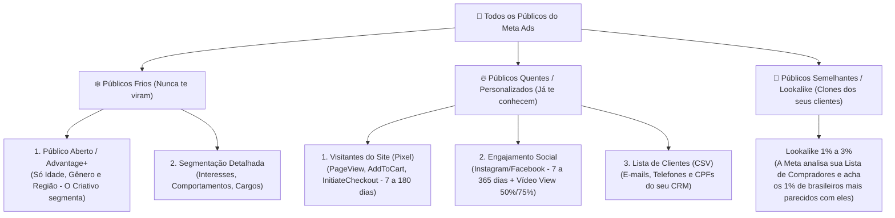

# Etapa 04.2 — Públicos, Segmentação e Estratégias no Meta Ads

## 1. A Temperatura dos Públicos no Meta Ads

No Meta Ads, existem **3 tipos técnicos de público**, que se encaixam diretamente nas temperaturas do nosso funil:



---

## 2. O Segredo da Exclusão de Públicos (Hierarquia de Conjuntos)

Se você criar um conjunto de **Interesses** e outro de **Público Aberto**, sem excluir quem já comprou ou quem está no seu Remarketing, os seus próprios conjuntos vão competir entre si pelo mesmo usuário!

Veja o desenho de uma **Hierarquia Limpa de Exclusão**:

```
+-----------------------------------------------------------------------+
| CONJUNTO 01 (Fundo de Funil - Remarketing Quente 7 a 14 dias)         |
| ✅ INCLUI: Abandonou Checkout / Visitou Página de Vendas (14D)        |
| ❌ EXCLUI: Compradores (Purchase 180D)                                |
+-----------------------------------------------------------------------+
                                   ^
                                   | (Quem entra aqui sai do de baixo)
+-----------------------------------------------------------------------+
| CONJUNTO 02 (Meio de Funil - Engajamento e Visitantes 30 a 60 dias)   |
| ✅ INCLUI: Engajou no Instagram (30D) + Visitou Site (30D)            |
| ❌ EXCLUI: Conjunto 01 (Checkout 14D) + Compradores (180D)            |
+-----------------------------------------------------------------------+
                                   ^
                                   | (Quem entra aqui sai do de baixo)
+-----------------------------------------------------------------------+
| CONJUNTO 03 (Topo de Funil - Público Frio: Aberto / Interesses / LAL) |
| ✅ INCLUI: Brasil (ou Cidade Local), 25-55 anos, Interesses / LAL 1%  |
| ❌ EXCLUI: Conjunto 01 + Conjunto 02 + Compradores (180D)             |
+-----------------------------------------------------------------------+
```

---

## 3. Como Estruturar na Prática? (3 Cenários Reais)

### Cenário A: Negócio Local (Ex.: Hamburgueria, Clínica de Estética, Academia)
* **Objetivo:** `Engajamento (Mensagens no WhatsApp)` ou `Cadastros (WhatsApp / LP)`.
* **Raio Geográfico:** Pino no endereço da loja com raio de **2 km a 8 km** (Pessoas que *moram* ou *estiveram recentemente* nesta localização).
* **Segmentação:** Como o raio geográfico já restringe muito a população (ex.: 150.000 pessoas no bairro), **não coloque dezenas de interesses**! Use **Público Aberto** (apenas idade e gênero do seu cliente ideal, ex.: Mulheres, 25 a 55 anos, no raio de 5km da clínica).
* **Criativos:** 3 anúncios dentro do conjunto (1 vídeo mostrando o ambiente/procedimento, 1 vídeo com oferta direta chamando para o WhatsApp, 1 imagem/carrossel de resultados).

### Cenário B: E-commerce (Loja Virtual)
* **Objetivo:** `Vendas` (Otimizado para o evento `Compra / Purchase` no Pixel).
* **Campanha 1 (Prospecção / Público Frio - 75% da verba):**
  * *Conjunto 01:* Público Aberto (Advantage+) — deixando o algoritmo encontrar compradores pelo criativo.
  * *Conjunto 02:* Interesses diretos no nicho (ex.: Moda Feminina, Zara, Farm, Compras Online).
  * *Conjunto 03:* Lookalike 1% de quem já comprou (`Purchase 180D`).
* **Campanha 2 (Remarketing + Catálogo Dinâmico DPA - 25% da verba):**
  * Mostra automaticamente a foto exata do produto que a pessoa viu ou colocou no carrinho nos últimos 14 dias, junto com um cupom de `PRIMEIRACOMPRA`.

### Cenário C: Infoproduto / Serviço Digital (Perpétuo ou Captação de Leads)
* **Objetivo:** `Vendas` (se for venda direta na página) ou `Cadastros` (se for captação de Lead).
* **Estrutura de Teste de Criativos (Regra 1-3-3):**
  * **1 Campanha**
  * **3 Conjuntos de Anúncios** (Público A: Aberto | Público B: Interesse Dor Principal | Público C: Lookalike 1% Clientes)
  * **3 Anúncios iguais dentro de cada conjunto** (Criativo 01: Gancho de Dor | Criativo 02: Gancho de Desejo | Criativo 03: Prova Social/Demonstração).
