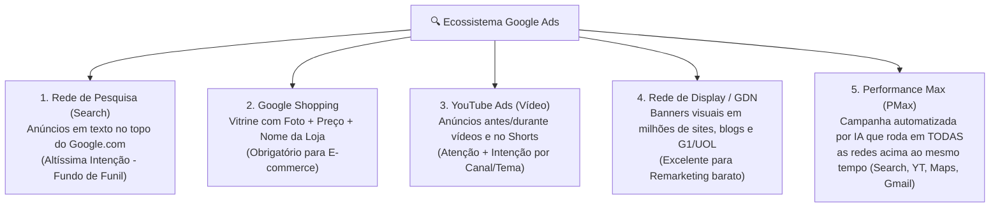

# Etapa 05.1 — Google Ads: Redes, Palavras-Chave e Correspondências

## 1. As 5 Grandes Redes do Ecossistema Google Ads

O Google Ads não é apenas a barra de pesquisa. Ele é dono dos maiores imóveis digitais do planeta:



---

## 2. A Lógica das Palavras-Chave (Intenção de Compra vs. Curiosidade)

Na Rede de Pesquisa, você compra as palavras que o seu cliente digita. Mas cuidado: **nem todo mundo que digita o nome da sua profissão quer contratar você!**

Veja a diferença entre uma palavra **Topo de Funil (Curioso/Estudante)** e uma palavra **Fundo de Funil (Comprador com Cartão na Mão)**:

```
+-----------------------------------------------------------------------+
| ❌ PALAVRAS DE CURIOSO (Gasta seu dinheiro e não compra):             |
| "advogado trabalhista quanto ganha", "como limpar sofá com bicarbonato"|
| "faculdade de odontologia preço", "fotos de bolos decorados"          |
+-----------------------------------------------------------------------+
| ✅ PALAVRAS DE COMPRADOR (Fundo de Funil - É aqui que está o lucro!): |
| "advogado trabalhista em curitiba consulta", "empresa limpeza de sofá"|
| "clínica implante dentário perto de mim", "encomendar bolo aniversário"|
+-----------------------------------------------------------------------+
```

---

## 3. Os 3 Tipos de Correspondência de Palavras-Chave (+ Negativas)

Como você diz ao Google o quão rígido ou flexível ele deve ser ao mostrar seu anúncio? Através dos **Símbolos de Correspondência**:

| Tipo de Correspondência | Símbolo no Google Ads | Exemplo Cadastrado | Para quem o anúncio APARECE? | Para quem NÃO aparece? |
| :--- | :---: | :---: | :--- | :--- |
| **1. Ampla** *(Broad Match)* | Sem símbolo | `limpeza de sofa` | Qualquer busca relacionada ao tema, inclusive sinônimos: *"higienização de estofados"*, *"como tirar mancha de sofá"*, *"lavar poltrona"* | Buscas totalmente fora do tema (⚠️ **Perigosa para iniciantes sem lista de negativas!**) |
| **2. De Frase** *(Phrase Match)* | Entre `"aspas"` | `"limpeza de sofa"` | Buscas que contenham o **sentido da frase**, mesmo com palavras antes ou depois: *"empresa de limpeza de sofá em sp"*, *"limpeza de sofá preço"* | Buscas que mudam o sentido central ou buscam apenas *"comprar sofá novo"* |
| **3. Exata** *(Exact Match)* | Entre `[colchetes]` | `[limpeza de sofa]` | Apenas quem buscar **exatamente esse termo ou variação com idêntica intenção**: *"limpeza de sofá"*, *"higienização de sofá"* | *"curso de limpeza de sofá"*, *"produto caseiro para limpar sofá"* |

### 🛡️ O Escudo Obrigatório: Palavras-Chave Negativas

Palavras negativas são termos que você **proíbe** o Google de acionar seu anúncio. Antes mesmo de ligar sua campanha de serviços ou produtos pagos, adicione uma lista universal de negativas:

```
🚫 LISTA BÁSICA DE NEGATIVAS PARA SERVIÇOS E PRODUTOS PAGOS:
- grátis / gratuito          - vaga / emprego / salário / currículo
- curso / aula / faculdade   - pdf / download / torrent / livro
- como fazer / caseiro       - wikipedia / significado / o que é
- reclame aqui / telefone 0800- usado / olx / mercado livre (se não for)
```

---

## 4. A Anatomia de um Anúncio Perfeito na Rede de Pesquisa (RSA)

Um anúncio campeão na busca do Google ocupa **o máximo de espaço possível na tela** para empurrar os concorrentes para baixo. Isso é feito combinando **Títulos + Descrições + Recursos (antigas Extensões)**:

```
+-----------------------------------------------------------------------+
| Patrocinado                                                           |
| 🌐 www.suaclinicaodonto.com.br/implantes/curitiba                     |
|                                                                       |
| Implante Dentário em Curitiba - Recupere Seu Sorriso em 72h           | <-- Títulos (Até 30 caract. cada)
| Avaliação com Tomografia 3D | Parcelamento em até 18x                 |
|                                                                       |
| Mais de 3.500 sorrisos transformados no Batel. Tecnologia sem corte   | <-- Descrição (Até 90 caract.)
| e pós-operatório tranquilo. Clique e agende sua avaliação pelo Whats! |
|                                                                       |
| ⭐ 4,9 (312 avaliações) · 📍 Av. do Batel, 1230 - Curitiba (a 1,8 km) | <-- Recurso de Local / Google Meu Negócio
| 📞 (41) 99999-0000 · 💬 Fale Conosco no WhatsApp                      | <-- Recursos de Chamada e Mensagem
|                                                                       |
| [ Implantes Carga Imediata ]   [ Lentes de Porcelana ]                | <-- Recursos de Sitelinks (Links Extras!)
| [ Conheça Nossa Estrutura  ]   [ Depoimentos Reais   ]                |
+-----------------------------------------------------------------------+
```

> **Por que preencher todos os Recursos (Sitelinks, Frases de Destaque, Snippets, Local, Chamada, Imagem)?**
> Porque eles são **100% gratuitos para exibir**, dobram o tamanho físico do seu anúncio na tela do celular e aumentam o seu CTR em até **25% a 40%**.
