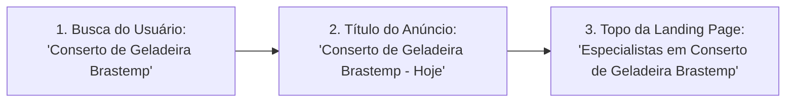
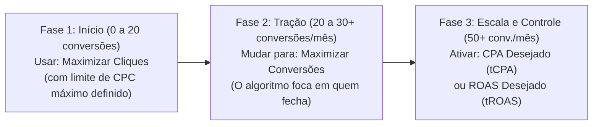

# Etapa 05.2 — Índice de Qualidade, Ad Rank e Estratégias de Lance no Google Ads

## 1. Como Pagar Menos que o Concorrente e Ficar em 1º Lugar no Google

No Google Ads, a posição do seu anúncio na página de busca é determinada por uma nota chamada **Ad Rank (Classificação do Anúncio)**, calculada a cada milissegundo:

$$\text{Ad Rank} = \text{Lance Máximo de CPC} \times \text{Índice de Qualidade (1 a 10)}$$

### Os 3 Pilares do Índice de Qualidade (Quality Score)

O Google dá uma nota de **1 a 10** para cada palavra-chave da sua conta baseada em 3 fatores:

```
              +-------------------------------------------+
              |     ⭐ ÍNDICE DE QUALIDADE (Nota 1 a 10)  |
              +---------------------+---------------------+
                                    |
         +--------------------------+--------------------------+
         |                          |                          |
         v                          v                          v
+-----------------+        +-----------------+        +-----------------+
| 1. CTR ESPERADO |        | 2. RELEVÂNCIA   |        | 3. EXPERIÊNCIA  |
|                 |        |    DO ANÚNCIO   |        | NA LANDING PAGE |
| As pessoas      |        | A palavra que o |        | A página abre   |
| clicam quando   |        | cliente digitou |        | rápido (<3s) e  |
| seu anúncio     |        | está escrita no |        | entrega exata-  |
| aparece?        |        | título do Ad?   |        | mente o prometi-|
+-----------------+        +-----------------+        +-----------------+
```

### A Regra da "Mensagem Combinada" (Message Match)

Para ter **Índice de Qualidade 9 ou 10/10**, a palavra exata que o usuário pesquisou precisa se repetir nos 3 elos da corrente:



* Se a pessoa digita `Conserto de Geladeira Brastemp`, seu anúncio diz *"Assistência Técnica de Eletrodomésticos em Geral"* e seu site abre na Home genérica falando sobre *"Fogões, Micro-ondas e Máquinas de Lavar"*, o seu Índice de Qualidade cai para **3/10** e o seu clique fica **3x mais caro**.

### Tabela Matemática do Leilão do Google Ads

Veja como a nota de qualidade faz você economizar dinheiro real:

| Concorrente | Lance Máx. (CPC) | Índice de Qualidade | Ad Rank (`Lance x Nota`) | Posição na Busca | Quanto Realmente Paga pelo Clique!* |
| :--- | :---: | :---: | :---: | :---: | :---: |
| **Você (Otimizado)** | R$ 4,00 | **10 / 10** | **40 pontos** | 🥇 **1º Lugar** | **R$ 2,41** |
| **Concorrente B** | R$ 6,00 | 4 / 10 | 24 pontos | 🥈 2º Lugar | R$ 4,01 |
| **Concorrente C** | R$ 8,00 | 2 / 10 | 16 pontos | 🥉 3º Lugar | — |

*\*Fórmula do CPC Real Pago no Google:* $\text{CPC Real} = \frac{\text{Ad Rank do Concorrente Abaixo}}{\text{Seu Índice de Qualidade}} + \text{R\$ } 0,01 = \frac{24}{10} + 0,01 = \text{R\$ } 2,41$.

---

## 2. Estratégias de Lance no Google Ads (Quando usar Manual vs. Inteligente?)

Quando você cria uma campanha nova do zero, o algoritmo da sua conta ainda não sabe quem é o seu comprador. Por isso, a estratégia de lance muda conforme a maturidade da campanha:



> ⚠️ **Erro Clássico no Google Ads:**
> Deixar "Maximizar Cliques" **sem preencher a caixinha de Limite de Lance Máximo de CPC**. Se você esquecer essa caixa em branco, o Google pode gastar R$ 35,00 em **um único clique** no seu primeiro dia! Sempre defina um teto (ex.: R$ 3,50 ou R$ 5,00 dependendo do Planejador de Palavras-Chave).
