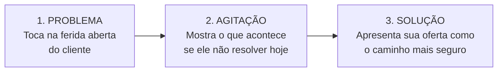

# Etapa 06.1 — Anatomia do Criativo Campeão e Copywriting para Anúncios

## 1. Por que "O Criativo é o Novo Público"?

Antigamente (em 2017), fazer tráfego era mexer em dezenas de botões técnicos de interesses ocultos. Hoje, com a Inteligência Artificial da Meta, do Google e do TikTok, **quem escolhe para quem o anúncio vai aparecer é o próprio Criativo (Vídeo ou Imagem)**.

Se o seu vídeo começa com a frase: *"Ei, você que é dono de restaurante com delivery em São Paulo..."*, as únicas pessoas que vão parar para assistir aos primeiros 3 segundos são donos de restaurantes! O algoritmo percebe isso imediatamente e passa a entregar o vídeo apenas para perfis semelhantes.

---

## 2. A Estrutura de Ouro de um Vídeo que Vende (Gancho + Corpo + CTA)

Um anúncio em vídeo de alta conversão (de 25 a 60 segundos para Reels/TikTok/Feed) é dividido em **3 blocos cirúrgicos**:

```
+=======================================================================+
| ⏱️ 0 a 3 SEGUNDOS: O GANCHO (HOOK) - 80% do sucesso do anúncio!       |
| Objetivo: Fazer o polegar da pessoa PARAR de rolar o feed.            |
| - Movimento visual rápido + Legenda grande + Frase que chama o público|
|   pela dor, desejo ou quebra de padrão. (NUNCA comece com "Olá, meu   |
|   nome é Fulano e hoje vim falar sobre...")                           |
+=======================================================================+
                                   |
                                   v
+=======================================================================+
| ⏱️ 3 a 35 SEGUNDOS: O CORPO (RETENÇÃO + MECANISMO + PROVA)            |
| Objetivo: Agitar o problema, mostrar a solução em ação e provar.      |
| - Mostre o produto funcionando na prática / bastidores / depoimento.  |
| - Quebre a principal objeção ("Sem precisar de...", "Mesmo que...").  |
+=======================================================================+
                                   |
                                   v
+=======================================================================+
| ⏱️ ÚLTIMOS 5 a 10 SEGUNDOS: A CHAMADA PARA AÇÃO (CTA)                 |
| Objetivo: Dizer exatamente onde clicar e por que clicar AGORA.        |
| - "Toque no botão 'Saiba Mais' aqui embaixo e garanta seu desconto..."|
+=======================================================================+
```

### 5 Exemplos de Ganchos (Hooks) Impossíveis de Ignorar

1. **Gancho de Chamada Direta (Qualificação):** *"Se você tem mais de 35 anos e sente dor no joelho ao subir escada, não pule esse vídeo."*
2. **Gancho de Erro Comum (Inversão):** *"Para de jogar dinheiro fora comprando [Solução Comum] antes de ver isso aqui..."*
3. **Gancho Visual / Demonstração (E-commerce):** *(Corta uma caixa abrindo ou derrama café em uma camisa impermeável nos primeiros 2 segundos)* *"Essa camisa repele qualquer líquido..."*
4. **Gancho de Curiosidade / Segredo:** *"Por que 9 em cada 10 clínicas em [Cidade] estão trocando o [Método Antigo] por isso aqui?"*
5. **Gancho de Prova / Comparação:** *"R$ 49,90 vs. R$ 450,00: qual a diferença real entre o nosso perfume e o importado?"*

---

## 3. Os 2 Frameworks Clássicos de Copywriting (Texto do Anúncio)

Não sabe o que escrever na legenda ou no roteiro do anúncio? Use um destes dois modelos testados há décadas:

### Modelo 1: Método PAS (Problema -> Agitação -> Solução)
Ideal para produtos ou serviços que **resolvem uma dor clara**.



* **Exemplo Prático (Contabilidade para Médicos):**
  * **[P] Problema:** *Médico, você sente que paga até 27,5% de imposto na pessoa física sem saber para onde vai tanto dinheiro?*
  * **[A] Agitação:** *A cada mês que você adia a abertura ou revisão do seu CNPJ médico, milhares de reais do seu plantão ficam retidos legalmente na Receita Federal — dinheiro que poderia estar investido no seu patrimônio.*
  * **[S] Solução:** *Com o Planejamento Tributário Médico da [Empresa], reduzimos sua alíquota para a faixa de 6% a 11% dentro da lei em até 15 dias. Toque em "Enviar Mensagem" e peça sua simulação gratuita no WhatsApp.*

### Modelo 2: Método AIDA (Atenção -> Interesse -> Desejo -> Ação)
Ideal para **E-commerce, Gastronomia, Estética, Moda e Infoprodutos**.

* **[A] Atenção (Título / 1ª linha):** *🔥 A Burger Week chegou no [Bairro]: 2 Smash Burgers Duplos + Batata Rústica por R$ 44,90!*
* **[I] Interesse:** *Carne Angus moída todos os dias, blend exclusivo na brasa, queijo cheddar inglês derretido e pão brioche amanteigado feito na casa.*
* **[D] Desejo:** *Chega quentinho na sua porta em até 35 minutos (ou o seu frete sai de graça!). Mais de 1.200 pedidos 5 estrelas só neste mês.*
* **[A] Ação (CTA):** *👇 Toque em "Pedir Agora" aqui abaixo e faça seu pedido em 1 minuto antes que o lote promocional de hoje acabe!*

---

## 4. Anatomia Visual de um Criativo Estático (Imagem / Carrossel)

Se você não tem vídeo ainda, imagens estáticas bem diagramadas vendem muito! Veja a hierarquia visual do olhar humano (Padrão em "Z"):

```
+---------------------------------------------------+
| [Tag Topo: "PARA MORADORES DE BELO HORIZONTE"]    | <-- 1. Filtro Geográfico/Público
|                                                   |
|   "LIMPEZA E HIGIENIZAÇÃO DE SOFÁ                 | <-- 2. Headline Grande e Clara
|    A SECO NA SUA CASA EM 2 HORAS"                 |    (Leitura em menos de 2 seg)
|                                                   |
|   +-------------------------------------------+   |
|   |                                           |   |
|   |       [ FOTO REAL DE ALTA NITIDEZ         |   | <-- 3. Imagem Protagonista
|   |         MOSTRANDO O SOFÁ SENDO LIMPO      |   |    (Contraste alto com o fundo)
|   |         COM EXTRATORA PROFISSIONAL ]      |   |
|   |                                           |   |
|   +-------------------------------------------+   |
|                                                   |
|   ✅ Elimina 99% dos ácaros, fungos e odores      | <-- 4. 3 Benefícios Rápidos
|   ✅ Secagem no mesmo dia                         |
|   ✅ Orçamento em 2 minutos pelo WhatsApp         |
|                                                   |
|      +-------------------------------------+      |
|      |  💬 CHAMAR NO WHATSAPP AGORA ->     |      | <-- 5. Botão Falso (CTA Visual)
|      +-------------------------------------+      |    (Aumenta o CTR em até 30%!)
+---------------------------------------------------+
```
