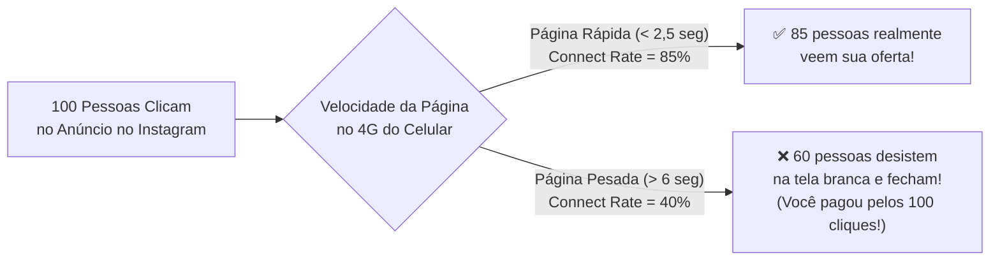

# Etapa 06.2 — Anatomia da Landing Page (Página de Vendas / Captura) de Alta Conversão

## 1. Site Institucional vs. Landing Page: Por que o seu "Site Normal" Mata as Vendas?

Um **Site Institucional** (com menu *"Quem Somos"*, *"História da Empresa"*, *"Blog"*, *"Redes Sociais"*, *"20 Serviços Diferentes"*) é um labirinto cheio de portas de saída. O usuário entra, se distrai e esquece de comprar.

Uma **Landing Page (Página de Aterrissagem)** tem **um único objetivo e um único botão de ação**. Ou a pessoa converte (compra/vira lead), ou ela fecha a aba.

```
+-----------------------------------+-----------------------------------+
|     ❌ SITE INSTITUCIONAL COMUM   |     ✅ LANDING PAGE DE TRÁFEGO    |
|  (Taxa de Conversão: 0,5% a 2%)   |  (Taxa de Conversão: 8% a 35%)    |
+-----------------------------------+-----------------------------------+
| [Home][Sobre][Blog][Fotos][Contato|      (SEM MENU DE DISTRAÇÃO)      |
|                                   |                                   |
|  "Bem-vindo à nossa empresa,      |  "Promessa Direta que Resolve a   |
|   fundada em 1998 com missão..."  |   Dor que estava no Anúncio"      |
|                                   |                                   |
|  [Link p/ Instagram] [Notícias]   |  [ VÍDEO / FOTO DO PRODUTO ]      |
|  [15 serviços misturados]         |  [ BOTÃO ÚNICO: QUERO AGORA ]     |
+-----------------------------------+-----------------------------------+
```

---

## 2. O Mapa Completo (Wireframe) de uma Landing Page Campeã

Veja o desenho estrutural, dobra por dobra, do que uma página precisa ter para converter desconhecidos em clientes:

```
+=======================================================================+
| DOBRA 1: ACIMA DA DOBRA (O que aparece sem rolar a tela - 80% do peso)|
|-----------------------------------------------------------------------|
| [Selo de Qualificação: "Exclusivo para Empresas com +10 funcionários"]|
|                                                                       |
| HEADLINE (Promessa Principal):                                        |
| "Reduza em até 40% o Custo da Energia da Sua Empresa sem Investir     |
|  1 Real em Placas Solares"                                            |
|                                                                       |
| SUB-HEADLINE (Como funciona + Quebra de Objeção):                     |
| "Através da Lei do Mercado Livre de Energia, sua indústria recebe     |
|  desconto direto na fatura em até 30 dias, sem obras e sem fidelidade"|
|                                                                       |
| [ VÍDEO CURTO DE 90s OU IMAGEM DE IMPACTO ]                           |
|                                                                       |
|          +-------------------------------------------------+          |
|          |   🟢 QUERO SIMULAR MINHA ECONOMIA GRATUITAMENTE |          |
|          +-------------------------------------------------+          |
|                 🔒 Dados 100% seguros · Simulação em 2 min            |
+=======================================================================+
| DOBRA 2: IDENTIFICAÇÃO COM A DOR / PARA QUEM É                        |
|-----------------------------------------------------------------------|
| "Você passa por alguma dessas situações hoje?"                        |
|  [❌ Conta de luz subindo todo ano]  [❌ Sem caixa p/ comprar placas] |
|  [❌ Imóvel alugado onde não vale fazer obra no telhado]              |
+=======================================================================+
| DOBRA 3: O MECANISMO ÚNICO (Como funciona em 3 passos simples)        |
|-----------------------------------------------------------------------|
|  (1) Envie sua fatura -> (2) Calculamos o desconto -> (3) Economize!  |
+=======================================================================+
| DOBRA 4: PROVA SOCIAL (Depoimentos Reais, Prints, Logos, Números)     |
|-----------------------------------------------------------------------|
|  ⭐⭐⭐⭐⭐ "Economizamos R$ 3.400/mês na nossa padaria" - Carlos M.   |
|  [Vídeo Depoimento 1]   [Print WhatsApp 2]   [Foto Cliente 3]         |
+=======================================================================+
| DOBRA 5: A OFERTA IRRESISTÍVEL + GARANTIA RISCO ZERO                  |
|-----------------------------------------------------------------------|
|  O que você recebe + Bônus + Preço Ancorado ("De R$ X por R$ Y")      |
|  🛡️ GARANTIA INCONDICIONAL DE 7 OU 30 DIAS                           |
|          +-------------------------------------------------+          |
|          |   🟢 GARANTIR MINHA VAGA / COMPRAR AGORA        |          |
|          +-------------------------------------------------+          |
+=======================================================================+
| DOBRA 6: QUEM SOMOS (Autoridade resumida) + FAQ (Perguntas Frequentes)|
|-----------------------------------------------------------------------|
|  [+] Precisa fazer obra?          [+] Tem multa de cancelamento?      |
|  [+] Em quanto tempo começa?      [+] É regulamentado pela ANEEL?     |
+=======================================================================+
```

---

## 3. A Métrica Silenciosa que Rouba 50% do seu Orçamento: O Connect Rate

O que acontece entre o momento em que o usuário **clica no anúncio** e o momento em que a **sua página termina de abrir**?

Essa taxa se chama **Taxa de Conectividade (Connect Rate)**:

$$\text{Connect Rate (\%)} = \left( \frac{\text{Visualizações da Página de Destino}}{\text{Cliques no Link}} \right) \times 100$$



### Checklist Técnico para Ter Connect Rate Acima de 80%

1. **Converta todas as imagens do site para `.WebP` ou `.AVIF`:** Nunca suba uma foto em `.PNG` de 4 MB na página! Comprima no [Squoosh.app](https://squoosh.app) ou TinyPNG para que cada imagem pese **menos de 100 KB**.
2. **Design Mobile-First (90% do tráfego do Meta Ads vem do celular):** Sempre teste e construa a página olhando na tela vertical do smartphone, não apenas no monitor largo do computador.
3. **Não carregue vídeos pesados do próprio servidor na Dobra 1:** Use players otimizados (VTurb, Panda Video, Vimeo otimizado ou YouTube com *lazy load*) para não travar o carregamento inicial da página.
4. **Use CDN (Cloudflare):** Ative o Cloudflare gratuito no seu domínio para entregar a página a partir do servidor mais próximo do usuário.
