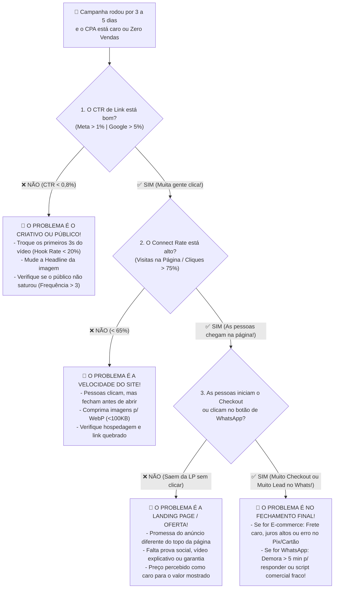

# Etapa 07.2 — Árvore de Decisão (Diagnóstico de Gargalos) e Métodos de Escala

## 1. Fluxograma Mestre de Diagnóstico: "Minha Campanha Não Vende, Onde Está o Erro?"

Quando uma campanha não traz lucro, **nunca saia mexendo em tudo ao mesmo tempo**. Siga o rastro do dinheiro na ordem cronológica com esta Árvore de Decisão:



---

## 2. Regras Práticas de Otimização Diária e Semanal

Para não destruir a fase de aprendizado do algoritmo, respeite o **Tempo de Maturação**:

| Situação | O que fazer? | Por quê? |
| :--- | :--- | :--- |
| **Campanha acabou de subir (Primeiras 24h)** | **NÃO MEXA EM NADA** (a menos que haja erro grave de link ou zero impressões). | O algoritmo está calibrando os primeiros leilões. |
| **Criativo gastou 1x o CPA Ideal e tem 0 vendas e CTR ruim (< 0,7%)** | **Pause o Criativo** e ative uma variação nova. | Ele já provou estatisticamente que não atrai cliques nem converte. |
| **Criativo tem vendas dentro do CPA Ideal, mas a Frequência passou de 3,0 no Público Frio** | **Saturação de Criativo!** Crie novos ângulos de vídeo/imagem. | O público já decorou o anúncio e o CPA vai começar a subir nos próximos dias. |
| **Conjunto está vendendo muito bem há 4 dias** | **Não edite público nem criativo dentro dele!** | Qualquer edição interna zera a Fase de Aprendizado e pode fazer as vendas pararem. |

---

## 3. Como Escalar Campanhas Lucrativas Sem Quebrar o ROAS

Você encontrou um conjunto e um criativo que gastam **R$ 50/dia** e voltam **R$ 200/dia** (ROAS 4x). Se você simplesmente mudar o orçamento de R$ 50 para R$ 500 de uma vez só, **o algoritmo entra em choque**, volta para a fase de aprendizado, entra em leilões caríssimos e o seu ROAS despenca.

Existem **2 formas profissionais de escalar**:

```
+-----------------------------------+-----------------------------------+
|      📈 1. ESCALA VERTICAL        |     ↔️ 2. ESCALA HORIZONTAL       |
|  (Aumentar verba no mesmo ativo)  |  (Expandir para novos bolsões)    |
+-----------------------------------+-----------------------------------+
|                                   |                                   |
|   [Conjunto Campeão: R$ 50/dia]   |   [Conjunto Campeão: R$ 50/dia]   |
|                 |                 |          /       |       \        |
|        +20% a 30% a cada          |         v        v        v       |
|           48h ou 72h              |     [Duplica] [Novo   ] [Nova   ] |
|                 v                 |     [em CBO ] [Público] [Rede   ] |
|          [R$ 65,00/dia]           |     [LAL 2% ] [Aberto ] [Google ] |
|                 v                 |                                   |
|          [R$ 85,00/dia]           |                                   |
|                 v                 |                                   |
|          [R$ 110,00/dia]          |                                   |
+-----------------------------------+-----------------------------------+
```

### Detalhamento das Técnicas de Escala:

1. **Escala Vertical Gradual (A Regra dos 20% a 30%):**
   * Aumente o orçamento do conjunto ou campanha vencedora em **no máximo 20% a 30% a cada 2 ou 3 dias**, desde que o CPA continue dentro da meta. Isso aumenta o volume sem resetar o aprendizado do algoritmo.
2. **Escala Horizontal por Públicos:**
   * Pegue o **Criativo Campeão** (use a opção *"Usar Publicação Existente / ID da Publicação"* para manter todas as curtidas e comentários acumulados!) e duplique para novos públicos: se venceu em *Lookalike 1%*, lance agora em *Lookalike 1% a 3%*, *Público Aberto* e *Novos Interesses*.
3. **Escala Horizontal de Criativos (Variações do Campeão):**
   * Se o `Vídeo 01` vendeu muito, grave **3 novos Ganchos (primeiros 3 segundos diferentes)** mantendo exatamente o mesmo corpo do vídeo vencedor! Assim você atinge pessoas novas no mesmo público.
