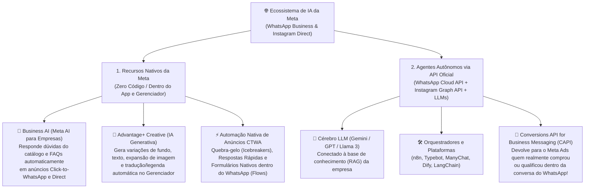
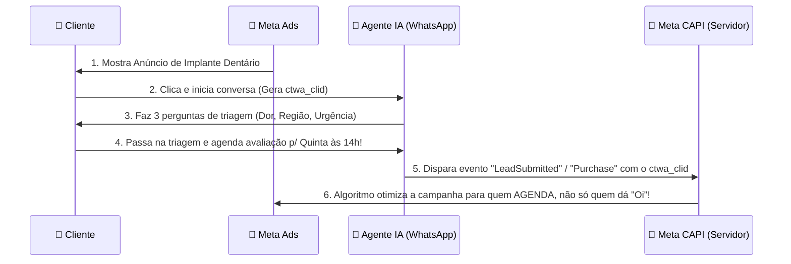

# Etapa 09.1 — Ecossistema de IA e Agentes da Meta (WhatsApp & Instagram)

## 1. Por que Unir Tráfego Pago + Agentes de IA no WhatsApp e Instagram?

O maior gargalo do tráfego pago no Brasil **não é gerar o clique ou a mensagem** — é o que acontece nos **primeiros 5 minutos** depois que o lead manda *"Olá, quero saber o preço"* no WhatsApp ou no Direct do Instagram.

Estudos de conversão mostram que:
* Responder um lead em **até 1 minuto** aumenta a taxa de conversão em **391%**.
* Passar de **5 minutos** derruba a chance de qualificação em **80%** (o lead esfria, volta para o Instagram ou fecha com o concorrente).
* **40% a 55% dos cliques de tráfego pago** no Meta Ads acontecem **à noite (19h às 23h30)** e nos **finais de semana**, exatamente quando a equipe comercial humana está offline!

### Desenho Visual: Atendimento Humano Tradicional vs. Agente de IA + Tráfego Pago

```
+-----------------------------------------------------------------------+
| ❌ CENÁRIO A: TRÁFEGO PAGO SEM AGENTE DE IA (Dinheiro Queimado)       |
|                                                                       |
| [Anúncio 21h30] ---> 👤 Lead manda "Oi" ---> 😴 Vendedor dormindo     |
|                                                   |                   |
| 💀 Lead não responde mais <--- "Bom dia!" (09h15) +                   |
| (Custo do Lead perdido + Algoritmo da Meta não recebe sinal de venda) |
+-----------------------------------------------------------------------+

+-----------------------------------------------------------------------+
| ✅ CENÁRIO B: TRÁFEGO PAGO + AGENTE DE IA (Máquina 24/7)              |
|                                                                       |
| [Anúncio 21h30] ---> 👤 Lead manda "Oi, vi o anúncio X"               |
|                           |                                           |
|                           v (Resposta em 3 segundos!)                 |
|             🤖 AGENTE DE IA (WhatsApp / Direct)                       |
|             1. Lê de qual anúncio o lead veio (CTWA Referral)         |
|             2. Escuta áudio do cliente e entende a dúvida (Whisper)   |
|             3. Qualifica (Orçamento, Urgência, Perfil)                |
|             4. Agenda na agenda ou gera link Pix/Checkout             |
|             5. Envia Evento "Purchase/QualifiedLead" p/ Meta (CAPI)!  |
+-----------------------------------------------------------------------+
```

---

## 2. Os Dois Mundos de IA no Ecossistema Meta (Nativo vs. API Oficial + LLM)

Para construir agentes no WhatsApp e Instagram integrados ao seu Tráfego Pago, você conta com **duas camadas de tecnologia**:



---

## 3. Como Funciona a Arquitetura Completa de um Agente de IA Conectado ao Meta Ads

Quando um usuário clica em um anúncio de **Click-to-WhatsApp (CTWA)** ou **Click-to-Instagram Direct (CTD)**, a Meta envia no pacote de dados oculto (`referral`) o **`source_id` (ID do Anúncio)** e o **`ctwa_clid` (Click ID do WhatsApp)**.

Veja o desenho técnico da arquitetura que os melhores gestores de tráfego e engenheiros de IA utilizam hoje:

```
+-----------------------------------------------------------------------+
| 1.📱 ANÚNCIO META ADS (Instagram Reels / Stories / Feed)              |
|    "Toque aqui para simular seu orçamento no WhatsApp"                |
+-----------------------------------+-----------------------------------+
                                    |
                                    | (Envia Mensagem + ctwa_clid + Ad_ID)
                                    v
+-----------------------------------------------------------------------+
| 2.💬 WHATSAPP CLOUD API / INSTAGRAM GRAPH API (Webhook Oficial)       |
+-----------------------------------+-----------------------------------+
                                    |
                                    v
+-----------------------------------------------------------------------+
| 3.⚙️ ORQUESTRADOR DO AGENTE (n8n / ManyChat / Backend Python/Node)    |
|                                                                       |
|   +-----------------------+       +-------------------------------+   |
|   | 🎙️ Transcrição Áudio  | ----> | 🧠 AGENTE LLM (Gemini / Llama)|   |
|   | (Cliente mandou áudio)|       | + Prompt de Vendas Consultivo |   |
|   +-----------------------+       | + RAG (PDFs, Tabela de Preços)|   |
|                                   +---------------+---------------+   |
|                                                   |                   |
|            +--------------------------------------+------+            |
|            | (Tools / Ferramentas que o Agente aciona)   |            |
|            v                      v                      v            |
|   [📅 Google Calendar]   [💳 Asaas/Stripe/Pix]   [🗂️ CRM / Kommo]    |
+-----------------------------------+-----------------------------------+
                                    |
                                    | (Quando o Lead agenda ou paga!)
                                    v
+-----------------------------------------------------------------------+
| 4.🎯 META CONVERSIONS API (CAPI FOR MESSAGING)                        |
|    Envia o ctwa_clid de volta para o Gerenciador de Anúncios:         |
|    "Ei Meta, o clique #98765 virou um Lead Qualificado de R$ 500!"    |
|    -> O Algoritmo aprende e passa a buscar só clientes que compram!   |
+-----------------------------------------------------------------------+
```

---

## 4. O Segredo de Ouro: CAPI para Mensagens (Otimização de Fundo de Funil no WhatsApp)

Por padrão, quando você sobe uma campanha de WhatsApp no Meta Ads, o algoritmo otimiza para **"Conversas Iniciadas"**. O problema? Muitas pessoas curiosas ou desqualificadas iniciam conversa e nunca compram, e a Meta acha que está fazendo um ótimo trabalho porque gerou muitas conversas baratas.

Quando o seu **Agente de IA** está integrado à **API de Conversões para Mensagens (Messaging Events API)**:



---

## 5. Os 4 Recursos Nativos da Meta que Você Deve Ativar Hoje

1. **Quebra-Gelo (Icebreakers) no Direct e WhatsApp:**
   Em vez de deixar a tela em branco quando o cliente clica no anúncio, exiba até 4 botões clicáveis prontos (ex.: *"1. Quero ver o cardápio e preços"*, *"2. Falar sobre entrega no meu bairro"*, *"3. Ver promoção do dia"*).
2. **WhatsApp Flows (Formulários Nativos dentro do Chat):**
   Permite que o Agente abra uma mini-tela interativa dentro do próprio WhatsApp para o cliente escolher data, horário, tamanho da roupa ou preencher CPF sem precisar digitar mensagem por mensagem.
3. **Catálogo Nativo do WhatsApp / Meta Commerce Manager:**
   O Agente de IA pode enviar carrosséis de produtos nativos do catálogo da Meta direto dentro da conversa do WhatsApp, permitindo que o usuário adicione ao carrinho sem sair do app.
4. **Gatilho de Comentário no Instagram (`Comment-to-DM`):**
   Nos seus anúncios (ou Reels orgânicos impulsionados), peça: *"Comente **EU QUERO** aqui embaixo que meu assistente vai te enviar o link com cupom no Direct agora mesmo!"*. Isso explode o engajamento do anúncio (derrubando o CPM) e inicia uma conversa automática no Direct.
