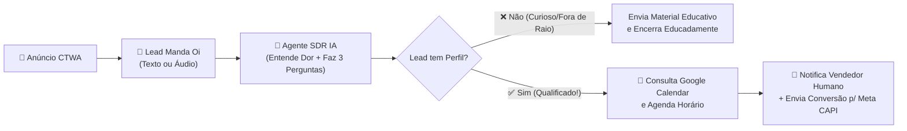
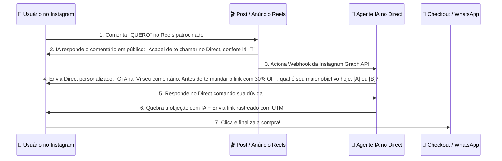
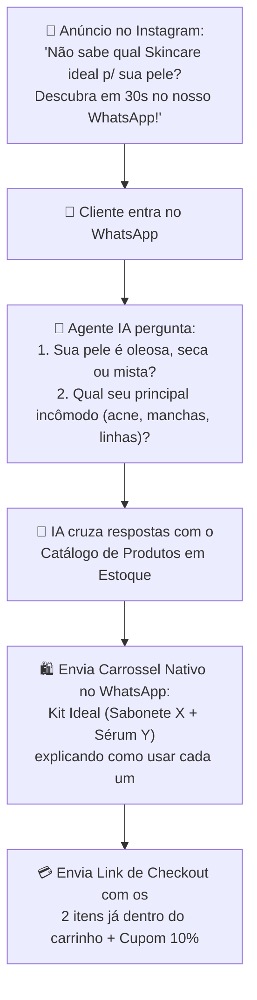
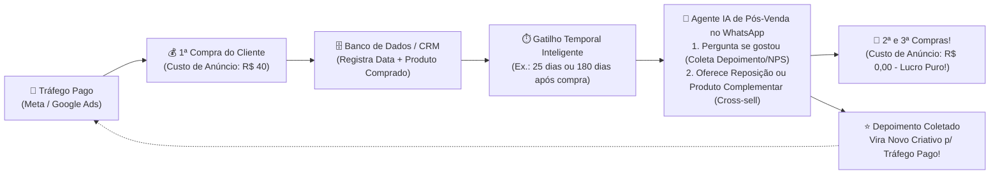

# Etapa 09.2 — 8 Ideias Práticas de Agentes de IA para WhatsApp e Instagram (Com Desenhos e Fluxogramas)

Aqui estão **8 projetos e arquiteturas completas de Agentes de IA** aplicados ao WhatsApp e ao Instagram para multiplicar o retorno (ROAS) das suas campanhas de Tráfego Pago.

---

## 🤖 Ideia 1: Agente SDR Qualificador e Agendador 24/7 (Clínicas, Advogados, B2B e Serviços)

### O Problema que Resolve
Em campanhas de WhatsApp para serviços (odontologia, estética, advocacia, energia solar, imóveis), 70% dos leads apenas perguntam *"Qual o valor?"* e somem se receberem uma resposta fria ou demorada.

### Como o Agente Funciona
Ele recebe o lead em 3 segundos, identifica exatamente **em qual anúncio o lead clicou** (pelo ID do anúncio), acolhe a dor com empatia, faz 3 perguntas naturais de qualificação (BANT), consulta a agenda real do profissional no Google Calendar, agenda o horário e já avisa o vendedor humano no grupo da equipe.

### Desenho Visual da Conversa e Bastidores

```
+-----------------------------------------------------------------------+
| 📱 TELA DO WHATSAPP DO CLIENTE         | 🧠 BASTIDORES DO AGENTE IA    |
+---------------------------------------+-------------------------------+
| 👤 Cliente (clicou no Ad de Implante):| -> Lê Ad_ID: "Campanha_Implan"|
| "Olá! Vi o anúncio e quero saber      | -> Carrega Prompt de Odonto   |
|  o preço do implante."                |                               |
|                                       |                               |
| 🤖 Agente IA (3 seg depois):          | -> Aplica técnica Spin Selling|
| "Olá, Marcos! Que bom ter você aqui   |    (Não joga preço seco sem   |
| na Clínica Sorriso. 😊 Para eu te     |     entender a necessidade)   |
| passar a estimativa certinha, você    |                               |
| busca repor 1 dente específico ou     |                               |
| seria a arcada completa?"             |                               |
|                                       |                               |
| 👤 Cliente (Manda ÁUDIO de 18 seg 🎙️):| -> Transcreve áudio c/ Whisper|
| "Então, eu perdi dois dentes do lado  | -> Extrai: 2 dentes + pressa  |
|  direito e queria fazer logo..."      | -> Classifica Lead = QUENTE 🔥|
|                                       |                               |
| 🤖 Agente IA:                         | -> Consulta Google Calendar   |
| "Entendi perfeitamente, Marcos! Para  |    do Dr. Rafael e acha       |
| 2 dentes adjacentes, conseguimos fazer|    2 janelas livres amanhã    |
| a carga rápida. O Dr. Rafael tem vaga |                               |
| para avaliação 3D amanhã às 14h ou    | -> Ao confirmar, cria evento  |
| às 16h30. Qual fica melhor para você?"|    e dispara CAPI p/ Meta Ads!|
+---------------------------------------+-------------------------------+
```

### Fluxograma Técnico (Mermaid)



---

## 📸 Ideia 2: Agente "Comente EU QUERO" no Instagram Direct (Engajamento + Venda no Piloto Automático)

### O Problema que Resolve
Anúncios tradicionais com botão *"Comprar Agora"* têm CTR mais baixo e CPM mais caro porque parecem propaganda. Já quando você faz um Reels mostrando um benefício incrível e diz **"Comente `DIAGNOSTICO` que eu te mando no Direct"**, o post recebe centenas de comentários, o algoritmo do Instagram entrega de graça para muito mais gente e o custo por lead despenca.

### Como o Agente Funciona
Diferente de um bot antigo que só joga um link frio no Direct e morre, o **Agente de IA inicia um diálogo consultivo no Direct**, tira as dúvidas do seguidor sobre o produto, lê o perfil dele e o conduz até a compra ou captura o WhatsApp dele.

### Fluxograma do Agente Comment-to-DM



---

## 🛒 Ideia 3: Agente Recuperador de Carrinho Abandonado e Pix Vencido via WhatsApp

### O Problema que Resolve
No E-commerce e nos Infoprodutos (Hotmart, Kiwify, Shopify, Yampi, WooCommerce), **de cada 100 pessoas que chegam no checkout, 70 abandonam sem pagar** (ou geram um Pix/Boleto e esquecem). E-mails de recuperação têm taxa de abertura de apenas 15%. No WhatsApp, a taxa de abertura é de **95%**.

### Como o Agente Funciona
Em vez de mandar uma mensagem robótica com cara de spam (*"Pague seu boleto aqui"*), o Agente de IA entra em contato **15 minutos após o abandono** agindo como um *Concierge de Suporte*: pergunta se houve algum erro técnico no cartão ou dúvida sobre o produto, quebra a objeção específica que travou o cliente e regenera o código Pix Copia-e-Cola na hora.

### Desenho Visual do Fluxo de Recuperação

```
[🛒 Checkout do Site: Cliente preencheu Nome + WhatsApp, mas fechou a aba]
                                    |
                     ⏱️ Aguarda 15 minutos sem evento Purchase
                                    |
                                    v
+-----------------------------------------------------------------------+
| 🤖 Agente IA no WhatsApp:                                             |
| "Oi Juliana, tudo bem? Aqui é a Sofia, da equipe da [Loja]. Vi que    |
| você estava separando o [Vestido Midi Linho M], mas o pedido não      |
| concluiu. Deu algum erro na tela do cartão ou ficou alguma dúvida     |
| sobre o tamanho/caimento? Posso medir a peça aqui pra você! 😊"       |
+-----------------------------------------------------------------------+
                                    |
       +----------------------------+----------------------------+
       |                                                         |
       v (Dúvida de Produto/Tamanho)                             v (Dúvida Financeira/Frete)
+-----------------------------------+             +-----------------------------------+
| 👤 "Fiquei com medo do M ficar    |             | 👤 "Achei o frete de R$ 28 meio   |
|     apertado no busto..."         |             |     salgado pra minha cidade..."  |
|                                   |             |                                   |
| 🤖 IA consulta Tabela de Medidas  |             | 🤖 IA libera Cupom de Frete Grátis|
|    no banco (RAG), confirma que o |             |    exclusivo válido por 2 horas   |
|    M veste até 96cm e tranquiliza!|             |    + envia Pix Copia e Cola!      |
+-----------------------------------+             +-----------------------------------+
```

---

## 👁️ Ideia 4: Agente Multimodal com Visão Computacional (Orçamento por Foto no WhatsApp)

### O Problema que Resolve
Muitos negócios dependem de **ver uma foto ou documento** do cliente para dar orçamento: oficinas de funilaria/martelinho de ouro, clínicas de estética/dermatologia/transplante capilar, assistência técnica, óticas (receita médica), energia solar (foto da conta de luz) ou decoração (foto da parede/sofá).

### Como o Agente Funciona
O anúncio no Instagram diz: *"Envie uma foto do seu sofá (ou da sua fatura de luz / receita) no nosso WhatsApp e receba o orçamento em 30 segundos!"*. O cliente manda a foto no WhatsApp, o **Agente de IA com Visão (Gemini Vision / GPT-4o Vision)** analisa a imagem, extrai os dados e entrega o pré-orçamento imediatamente!

### Desenho da Arquitetura Multimodal (Exemplo: Energia Solar / Higienização de Sofá)

```
+-----------------------------------------------------------------------+
| 👤 CLIENTE NO WHATSAPP:                                               |
| [ 📷 Envia FOTO de um Sofá de 3 lugares com Chaise sujo ]             |
| "Quanto fica pra limpar esse sofá aqui?"                              |
+-----------------------------------+-----------------------------------+
                                    |
                                    v
+-----------------------------------------------------------------------+
| 👁️ AGENTE DE VISÃO COMPUTACIONAL (Gemini Pro Vision):                 |
| 1. Analisa os pixels da imagem enviada pelo WhatsApp.                 |
| 2. Identifica: "Sofá Retrátil em L com Chaise, Tecido Suede/Linho,    |
|    Aproximadamente 3 a 4 assentos, manchas superficiais visíveis".    |
| 3. Cruza com a Tabela de Preços da Empresa: Categoria G = R$ 240,00.  |
+-----------------------------------+-----------------------------------+
                                    |
                                    v
+-----------------------------------------------------------------------+
| 🤖 RESPOSTA DO AGENTE NO WHATSAPP (em 10 segundos):                   |
| "Que sofá lindo! Pela foto, vi que ele é um modelo retrátil com       |
| chaise (porte grande, tecido claro). ✨                               |
|                                                                       |
| Para deixarmos ele 100% higienizado, livre de manchas e ácaros na     |
| sua casa, o investimento é de R$ 240 (ou 3x de R$ 80 sem juros).      |
| Temos equipe na sua região na quinta pela manhã. Quer reservar?"      |
+-----------------------------------------------------------------------+
```

---

## 🛍️ Ideia 5: Agente Personal Shopper com Recomendação de Catálogo no WhatsApp

### O Problema que Resolve
O cliente vê um anúncio da sua loja de suplementos, cosméticos, vinhos, presentes ou roupas, mas **não sabe qual produto escolher** para o caso dele. Se você jogar ele na Home do e-commerce com 300 produtos, ele fica confuso e sai.

### Como o Agente Funciona
O anúncio leva para um **Quiz Conversacional com IA no WhatsApp ou Direct**. O Agente faz 3 perguntas rápidas sobre o gosto ou necessidade do cliente, consulta o estoque real da loja (via API da Shopify/Nuvemshop ou Catálogo da Meta) e monta uma **cesta personalizada com foto, explicação do porquê escolheu aquele item e link direto para o carrinho já preenchido**.

### Fluxograma do Personal Shopper IA



---

## 🎯 Ideia 6: Agente "Caçador de Intenção" nos Comentários de Anúncios (Social Listening + Venda)

### O Problema que Resolve
Quando você roda campanhas de Meta Ads com verba alta, seus anúncios recebem dezenas ou centenas de comentários todos os dias:
1. **Comentários de Compra:** *"Qual o valor?"*, *"Entrega em Curitiba?"*, *"Tem tamanho G?"* (Se você não responder rápido e chamar no Direct, você perde a venda!).
2. **Comentários de Haters / Spam:** Pessoas fazendo propaganda nos seus anúncios ou comentários ofensivos que espantam compradores e **derrubam o seu ROAS pela metade**.

### Como o Agente Funciona
Conectado ao webhook de comentários da página/Instagram, o Agente de IA lê cada novo comentário no anúncio em tempo real e classifica o sentimento em 3 gavetas:

```
                   [ 💬 NOVO COMENTÁRIO NO SEU ANÚNCIO PAGO ]
                                       |
                                       v
                     +-----------------------------------+
                     | 🧠 AGENTE CLASSIFICADOR DE IA     |
                     +-----------------+-----------------+
                                       |
         +-----------------------------+-----------------------------+
         |                             |                             |
         v (Dúvida / Intenção Compra)  v (Elogio / Prova Social)     v (Spam / Ofensa / Concorrente)
+--------------------+       +--------------------+        +--------------------+
| 🟢 GAVETA 1: LEAD  |       | 🔵 GAVETA 2: FÃ    |        | 🔴 GAVETA 3: TÓXICO|
| 1. Curte o coment. |       | 1. Curte e responde|        | 1. OCULTA (Hide) o |
| 2. Responde público|       |    agradecendo com |        |    comentário na   |
| 3. Abre conversa   |       |    carinho (aumenta|        |    hora via API!   |
|    no Direct com a |       |    relevância do   |        | 2. Protege a prova |
|    resposta + link!|       |    anúncio no leilão|       |    social do Ad!   |
+--------------------+       +--------------------+        +--------------------+
```

---

## 🔄 Ideia 7: Agente de Reativação de Base, Upsell e LTV no WhatsApp (Custo de Tráfego Zero!)

### O Problema que Resolve
Você já pagou caro no Meta Ads ou Google Ads para adquirir o cliente na primeira compra (CAC). Se você vender para ele **apenas uma vez**, sua margem é apertada. O lucro real do tráfego pago está na **2ª, 3ª e 4ª compra (LTV - Lifetime Value)**, onde o custo de anúncio é **R$ 0,00**!

### Como o Agente Funciona
Integrado ao seu CRM ou ERP, o Agente monitora o **ciclo de vida do produto** e aborda o cliente no WhatsApp no momento exato de reposição ou manutenção:
* **Exemplo Suplemento / Ração Pet / Cosmético:** Sabe que o pote dura 30 dias. No **dia 25**, o Agente manda mensagem perguntando como foram os resultados e oferece a reposição com 1 clique antes de acabar.
* **Exemplo Clínica / Dentista / Oficina:** Sabe que a limpeza dentária ou troca de óleo venceu há 6 meses. O Agente chama o cliente pelo nome, lembra da data da última visita e já oferece 2 horários para a revisão.

### Fluxograma do Ciclo Infinito de LTV



---

## 📊 Ideia 8: Agente "Copiloto do Gestor de Tráfego" (Relatórios e Alertas do Meta Ads direto no seu WhatsApp)

### O Problema que Resolve
O gestor de tráfego (ou dono de negócio) precisa abrir o Gerenciador de Anúncios várias vezes ao dia para checar se o saldo acabou, se alguma campanha parou de entregar, se o CPA explodiu ou para montar relatórios semanais para os clientes.

### Como o Agente Funciona
Um Agente de IA conectado à **Meta Marketing API** roda todos os dias às 08h00 da manhã (e a cada 2 horas em segundo plano), analisa as métricas de todas as campanhas ativas, interpreta os números usando as regras da nossa **Árvore de Decisão (Etapa 07)** e envia um **resumo executivo inteligente direto no WhatsApp do Gestor ou do Cliente**!

### Desenho Visual do Relatório que o Agente Envia no Seu WhatsApp

```
+-----------------------------------------------------------------------+
| 📱 WHATSAPP DO GESTOR / DONO DA EMPRESA (08:00 AM)                    |
+-----------------------------------------------------------------------+
| 🤖 Agente Copiloto de Tráfego:                                        |
| "Bom dia! ☀️ Aqui está o Raio-X das suas campanhas de ontem (23/11):  |
|                                                                       |
| 💰 Investimento Total: R$ 340,00                                      |
| 🎯 Conversões: 14 Vendas (CPA Médio: R$ 24,28 | Meta: R$ 35,00) ✅    |
| 📈 Faturamento Rastreado: R$ 2.100,00 (ROAS: 6,17x)                   |
|                                                                       |
| 🔍 DIAGNÓSTICO AUTOMÁTICO DA IA:                                      |
| 1. 🏆 DESTAQUE: O criativo '[AD 02] Vídeo Gancho Dor' no Conjunto     |
|    'Aberto' gerou 9 vendas a R$ 18,50 (CTR 2,4%). Recomendo escala    |
|    vertical de +25% no orçamento hoje.                                |
| 2. ⚠️ ALERTA DE FADIGA: O criativo '[AD 01] Imagem Estática' bateu    |
|    Frequência 3,4 e o CTR caiu para 0,6% sem vendas há 48h.           |
|                                                                       |
| 👉 Responda '1' para eu aplicar o aumento de 25% no Conjunto Campeão  |
|    e pausar o [AD 01] automaticamente via API, ou '2' para manter."   |
+-----------------------------------------------------------------------+
```

---

## 🛠️ Resumo: Stack de Ferramentas para Construir Esses 8 Agentes

Você não precisa programar tudo do zero. Veja as ferramentas mais usadas no mercado para tirar qualquer uma das 8 ideias do papel:

| Camada do Agente | Ferramentas No-Code / Low-Code (Mais Rápidas) | Ferramentas Pro-Code / Avançadas (Maior Escala) |
| :--- | :--- | :--- |
| **Conexão Oficial Instagram & WhatsApp** | **ManyChat** (Parceiro Oficial Meta), ** Respond.io**, **SleekFlow** | **WhatsApp Cloud API Oficial (Meta for Developers)** + **Instagram Graph API** |
| **Orquestração e Automações (O "Sistema Nervoso")** | **n8n** *(o padrão ouro atual para agentes)*, **Make.com**, **Typebot** | **Python (FastAPI + LangGraph / CrewAI)** ou **Node.js** |
| **Cérebro de IA (LLMs & Visão)** | **Google Gemini API (Gemini 2.5 Flash / Pro)**, **OpenAI API (GPT-4o + Whisper)** | Modelos próprios ou **Llama 3 (Meta)** via Groq / Vertex AI |
| **Memória e Base de Conhecimento (RAG)** | **Supabase (pgvector)**, **Pinecone**, **Dify.ai** | **PostgreSQL + pgvector + Redis** (para memória da conversa no WhatsApp) |
| **CRM de Vendas no WhatsApp** | **Kommo CRM**, **HubSpot**, **RD Station CRM**, **Clint** | CRM próprio integrado via Webhook + **Meta Conversions API (CAPI)** |
