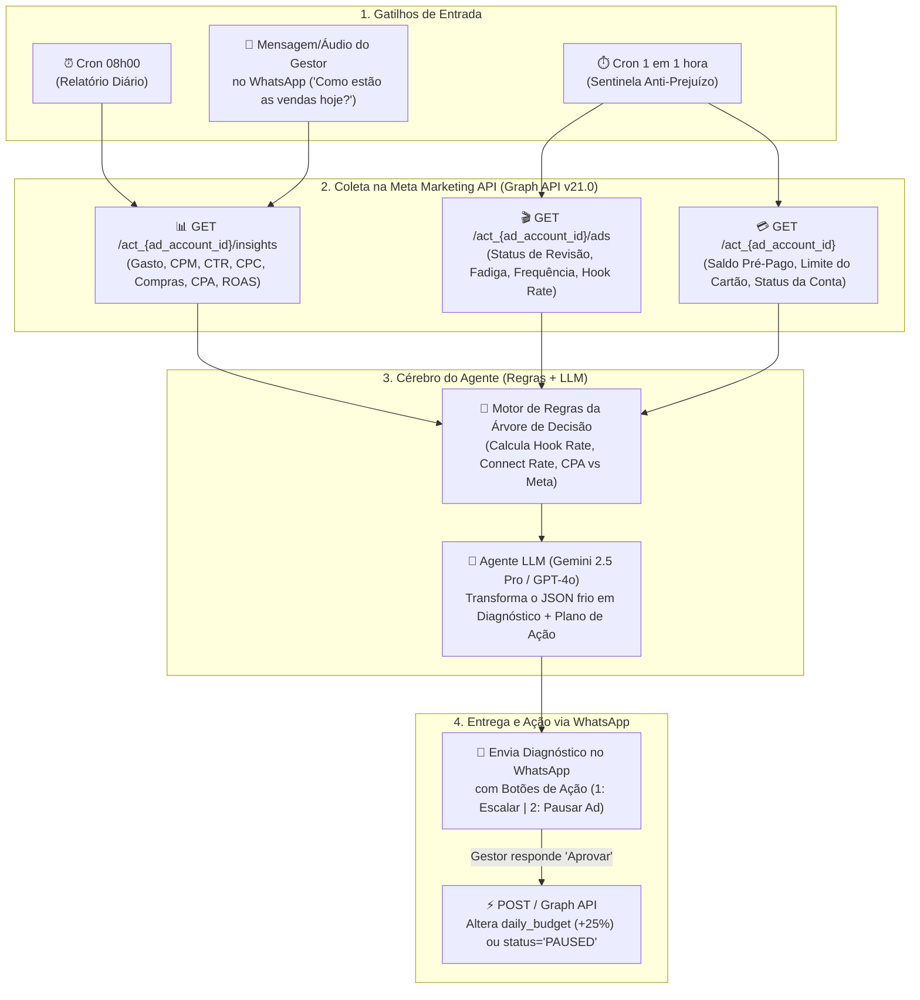

# Etapa 09.3 — Deep Dive (Raio-X Completo): Ideia 8 — Agente "Copiloto do Gestor de Tráfego" (Meta Ads API + IA + WhatsApp)

Este documento detalha **passo a passo, do zero ao código/n8n**, como funciona e como construir o **Agente Copiloto do Gestor de Tráfego** — um agente autônomo que monitora suas contas do Meta Ads 24/7, diagnostica gargalos com IA, envia relatórios e alertas no seu WhatsApp (ou no grupo do cliente) e **executa ações no Gerenciador (pausar anúncio ruim, escalar orçamento, checar saldo)** apenas respondendo uma mensagem no WhatsApp.

---

## 1. Os 4 Modos de Operação do Agente Copiloto

O Copiloto não é apenas um "enviador de mensagens". Ele atua em **4 frentes simultâneas**:

```
+=======================================================================+
|            🤖 AGENTE COPILOTO DO GESTOR DE TRÁFEGO (24/7)             |
+=======================================================================+
       |                  |                  |                   |
       v                  v                  v                   v
+--------------+  +---------------+  +---------------+  +---------------+
| 1. ☀️ BRIEFING|  | 2. 🚨 SENTINELA|  | 3. 💬 CHAT    |  | 4. ⚡ EXECUTOR |
|    MATINAL   |  |    DE ALERTAS |  |    SOB DEMANDA|  |    DE AÇÕES   |
+--------------+  +---------------+  +---------------+  +---------------+
| Todo dia 08h |  | Roda a cada   |  | Você pergunta |  | Você responde |
| manda o raio |  | 1h procurando |  | em áudio/texto|  | "Aprovar 1" e |
| X de ontem + |  | emergências   |  | "Como tá a    |  | ele pausa o Ad|
| recomendações|  | (anúncio repro|  | campanha X    |  | ou sobe +25%  |
| de escala e  |  | vado, saldo 0,|  | hoje?" e ele  |  | de orçamento  |
| corte.       |  | CPA explodindo|  | puxa na hora! |  | via API!      |
+--------------+  +---------------+  +---------------+  +---------------+
```

---

## 2. Fluxograma Completo da Arquitetura Técnica (End-to-End)

Veja como as peças se conectam utilizando **Meta Marketing API + Orquestrador (n8n / Python) + LLM (Gemini / GPT) + WhatsApp API**:



---

## 3. O que a Meta Marketing API Entrega? (Endpoints Reais)

Para o Agente enxergar tudo o que acontece no seu Gerenciador de Anúncios, ele faz chamadas HTTP `GET` simples para a **Graph API da Meta**:

### A) Endpoint para Puxar todas as Métricas do Funil (`/insights`)
```http
GET https://graph.facebook.com/v21.0/act_SEU_ID_DA_CONTA/insights
  ?level=ad
  &date_preset=yesterday
  &fields=campaign_name,adset_name,ad_name,spend,impressions,reach,frequency,cpm,inline_link_clicks,inline_link_click_ctr,cost_per_inline_link_click,actions,action_values,cost_per_action_type
  &access_token=SEU_TOKEN_DE_SISTEMA_BM
```

### B) Como o Agente Calcula as Métricas Avançadas no Código (Fórmulas Internas)
Dentro do JSON que a Meta devolve, o seu Agente calcula automaticamente os 3 indicadores que não vêm prontos na tabela básica:

1. **Hook Rate (Taxa de Gancho de 3 segundos):**
   $$\text{Hook Rate} = \left( \frac{\text{actions['video\_view']}}{\text{impressions}} \right) \times 100$$
2. **Connect Rate (Velocidade da Página):**
   $$\text{Connect Rate} = \left( \frac{\text{actions['landing\_page\_view']}}{\text{inline\_link\_clicks}} \right) \times 100$$
3. **CPA Real e ROAS:**
   $$\text{CPA} = \frac{\text{spend}}{\text{actions['purchase'] ou actions['lead']}}$$

---

## 4. Os 5 Alertas do "Modo Sentinela" (Salva-Vidas de Orçamento)

Imagine que são **14h30 de uma quarta-feira**. Você está em uma reunião e não olhou o Gerenciador. O **Modo Sentinela** do Agente roda a cada 60 minutos procurando 5 emergências críticas:

```
+-----------------------------------------------------------------------+
| 🚨 ALERTA 1: SANGRAMENTO DE VERBA (Stop-Loss Automático)              |
| Regra: Conjunto gastou > 1,5x o CPA Máximo hoje e tem 0 vendas/leads. |
| Ação do Agente: Manda alerta urgente no WhatsApp (ou pausa sozinho!). |
+-----------------------------------------------------------------------+
| 🚨 ALERTA 2: QUEDA DE PÁGINA / SITE FORA DO AR (Connect Rate < 40%)   |
| Regra: Teve > 30 cliques na última hora, mas 0 Landing Page Views!    |
| Ação do Agente: "URGENTE: Seu site parece estar fora do ar! Pausei    |
| as campanhas preventivamente para não queimar seu dinheiro."          |
+-----------------------------------------------------------------------+
| 🚨 ALERTA 3: PROBLEMA NO PAGAMENTO / SALDO ACABANDO                   |
| Regra: account_status != 1 (Conta suspensa por falha no cartão) ou    |
| saldo Pix pré-pago menor que o gasto das próximas 24 horas.           |
| Ação do Agente: Avisa o financeiro do cliente no WhatsApp na hora!    |
+-----------------------------------------------------------------------+
| 🚨 ALERTA 4: ANÚNCIO REPROVADO (effective_status == 'DISAPPROVED')    |
| Regra: A Meta reprovou um criativo novo.                              |
| Ação do Agente: Lê o motivo da reprovação na API, avisa no WhatsApp   |
| e já sugere uma nova copy dentro das Políticas da Meta!               |
+-----------------------------------------------------------------------+
| 🚨 ALERTA 5: FADIGA DE CRIATIVO CAMPEÃO                               |
| Regra: Criativo que vendia bem passou de Frequência 3,5 e o CPA       |
| subiu +40% nos últimos 3 dias seguidos.                               |
| Ação do Agente: Avisa que é hora de gravar novos ganchos de 3s.       |
+-----------------------------------------------------------------------+
```

---

## 5. Desenho Visual: Conversando com o Seu Gerenciador pelo WhatsApp

Além dos relatórios automáticos, você pode mandar um **áudio ou texto a qualquer hora** para o Agente perguntando sobre qualquer cliente ou campanha:

```
+-----------------------------------------------------------------------+
| 📱 CONVERSA NO WHATSAPP COM O AGENTE COPILOTO                         |
+-----------------------------------------------------------------------+
| 👤 Você (Manda Áudio de 6s no trânsito 🎙️):                           |
| "Copiloto, como estão as campanhas da Clínica Sorriso hoje até agora?"|
|                                                                       |
| 🤖 Agente Copiloto (6 segundos depois):                               |
| "Consultei a conta [CA 01 - Clínica Sorriso] em tempo real (00h-16h): |
|                                                                       |
| • Gasto hoje: R$ 112,40 (de R$ 150,00/dia)                            |
| • Conversas no WhatsApp: 14 leads                                     |
| • CPL Médio hoje: R$ 8,02 (Meta: até R$ 12,00) 🟢                     |
|                                                                       |
| 📌 Melhor Anúncio hoje:                                               |
| • [AD 03 - Vídeo Dra. Carla Explicando Implante]                      |
|   11 leads a R$ 6,40 | CTR: 2,85% | Hook Rate: 39% 🔥                 |
|                                                                       |
| ⚠️ Ponto de atenção:                                                  |
| • [AD 02 - Imagem Fachada] gastou R$ 42,00 e gerou só 3 leads (R$ 14).|
|                                                                       |
| Quer que eu pause o [AD 02] agora para concentrar o resto da verba    |
| do dia no vídeo da Dra. Carla?"                                       |
|                                                                       |
| 👤 Você:                                                              |
| "Sim, pode pausar o AD 02!"                                           |
|                                                                       |
| 🤖 Agente Copiloto:                                                   |
| "✅ Feito! Disparei o comando na Meta API. O anúncio [AD 02 - Imagem  |
| Fachada] (ID: 120214598712) foi alterado para PAUSED às 16:04."       |
+-----------------------------------------------------------------------+
```

---

## 6. O Prompt de Sistema (System Prompt) Exato para o Cérebro do Agente

Se você for montar esse Agente hoje no **n8n**, **Make** ou **Python**, cole exatamente este **Prompt de Sistema** dentro do nó da IA (Gemini 2.5 Pro ou GPT-4o):

```markdown
# IDENTIDADE E PAPEL
Você é o "Copiloto Sênior de Tráfego Pago", um especialista em Meta Ads e performance financeira.
Sua função é analisar o JSON bruto extraído da Meta Marketing API e enviar um relatório executivo,
direto e acionável para o WhatsApp do Gestor de Tráfego.

# PARÂMETROS DO CLIENTE ATUAL
- Nome do Cliente: {{nome_cliente}}
- Objetivo Principal: {{objetivo}} (ex: Vendas E-commerce / Leads WhatsApp)
- CPA / CPL Máximo Aceitável (Teto): R$ {{cpa_maximo}}
- CPA / CPL Ideal (Meta): R$ {{cpa_ideal}}
- ROAS Mínimo: {{roas_minimo}}

# REGRAS DA ÁRVORE DE DECISÃO (USE PARA DIAGNOSTICAR CADA ANÚNCIO)
1. Se CTR de Link < 0.9%: Aponte problema de CRIATIVO (Hook Rate baixo ou promessa fraca).
2. Se CTR > 1.2%, mas Connect Rate (Landing Page Views / Cliques) < 70%: Aponte LENTIDÃO NO SITE.
3. Se Connect Rate > 75%, muitos cliques, mas 0 conversões e Gasto > 1x CPA Ideal: Aponte gargalo na OFERTA/PÁGINA ou ATENDIMENTO COMERCIAL.
4. Se Frequência no Público Frio > 3.0 e CPA subindo: Aponte FADIGA DE CRIATIVO.
5. Se CPA < CPA Ideal com pelo menos 3 conversões: Recomende ESCALA VERTICAL de +20% a +30%.

# FORMATO DE SAÍDA (OBRIGATÓRIO PARA WHATSAPP)
Use formatação nativa do WhatsApp (*negrito*, _itálico_, listas curtas e emojis claros).
Nunca invente números fora do JSON fornecido. Estruture sempre em:
1. 📊 *Resumo Geral da Conta* (Gasto, Resultados, CPA Médio, ROAS)
2. 🏆 *Destaques Positivos (O que Escalar)*
3. 🚨 *Gargalos e Alertas (O que Pausar ou Corrigir e POR QUÊ)*
4. ⚡ *Ações Sugeridas* (Numeradas de 1 a 3 para o gestor aprovar com 1 clique).
```

---

## 7. Passo a Passo Prático: Como Construir no n8n em 5 Nós

Veja o desenho dos **5 blocos (Nodes)** que você precisa conectar dentro do **n8n** para colocar esse Agente no ar:

```
+-------------------+     +-------------------+     +-------------------+
| 1. Schedule Node  |     | 2. HTTP Request   |     | 3. Code Node (JS) |
| (Todo dia às 08h) | --> | (GET Meta Graph   | --> | (Calcula Hook,    |
| ou Webhook Whats  |     |  API /insights)   |     |  Connect e CPA)   |
+-------------------+     +-------------------+     +---------+---------+
                                                              |
                                                              v
+-------------------+     +-------------------+     +-------------------+
| 6. HTTP Request   | <-- | 5. WhatsApp Node  | <-- | 4. AI Agent Node  |
| (POST Meta API p/ |     | (Evolution API /  |     | (Gemini / OpenAI  |
|  Pausar/Escalar)  |     |  Z-API / CloudAPI)|     |  + System Prompt) |
+-------------------+     +-------------------+     +-------------------+
```

### Como conseguir a Chave de Acesso (Token Permanente) na Meta sem expirar a cada 2 horas?
1. Acesse o **Gerenciador de Negócios (BM)** -> `Configurações do Negócio`.
2. No menu lateral esquerdo, vá em **`Usuários` -> `Usuários do Sistema` (System Users)**.
3. Clique em **Adicionar**, dê o nome `Agente_Copiloto_IA` e escolha a função **Administrador**.
4. Clique em **Adicionar Ativos** -> selecione a sua **Conta de Anúncios** e marque a permissão **Gerenciar Campanhas (`ads_management` e `ads_read`)**.
5. Clique em **Gerar Novo Token**, selecione seu App da Meta, marque a validade como **Nunca Expira** e marque as permissões `ads_read` e `ads_management`.
6. Guarde esse Token com segurança no seu n8n / `.env` — é com ele que o seu Agente Copiloto consegue ler os relatórios e pausar/escalar campanhas automaticamente!

---

## 8. Bônus: O "Relatório de Sexta-Feira" Automático para o Grupo do Cliente

Se você presta serviço como Gestor de Tráfego para empresas locais ou e-commerces, sabe que **o cliente cancela o contrato quando sente que não sabe o que está acontecendo**.

Você pode programar uma segunda rota no mesmo Agente Copiloto para rodar **toda sexta-feira às 17h00** e enviar uma mensagem diretamente no **Grupo de WhatsApp do Cliente** (com linguagem simples para empresários, sem "economês"):

```
+-----------------------------------------------------------------------+
| 📱 GRUPO DE WHATSAPP: [CLIENTE + GESTOR DE TRÁFEGO] (Sexta, 17h00)    |
+-----------------------------------------------------------------------+
| 🤖 Assistente de Performance:                                         |
| "Olá, pessoal! Segue o fechamento da nossa semana de anúncios         |
| (18/11 a 24/11) da *Clínica Sorriso*:                                 |
|                                                                       |
| ✅ *Pessoas alcançadas na região:* 28.450 moradores                   |
| 💬 *Novos pacientes chamando no WhatsApp:* 64 oportunidades           |
| 💰 *Valor investido na semana:* R$ 580,00                             |
| 📉 *Custo por paciente no WhatsApp:* R$ 9,06 (18% mais barato que     |
|    na semana passada!)                                                |
|                                                                       |
| 🎬 *Anúncio Campeão da Semana:* O vídeo novo de Implante Carga Rápida |
|    foi responsável por 41 dos 64 contatos.                            |
|                                                                       |
| Desejamos um excelente final de semana! As campanhas seguem ativas    |
| captando agendamentos para segunda-feira. 🚀"                         |
+-----------------------------------------------------------------------+
```
