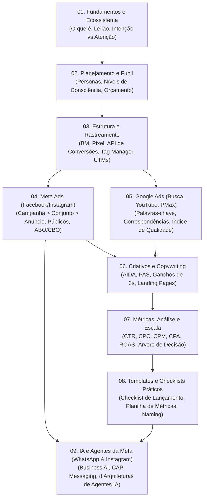

# 🚀 Guia Definitivo de Tráfego Pago — Do Zero à Escala

Bem-vindo à sua base de conhecimento completa sobre **Gestão de Tráfego Pago (Mídia Paga / Performance)**. Este repositório foi estruturado em **8 etapas cronológicas e práticas**, desenhadas de forma didática, com **desenhos visuais (ASCII Art)**, **fluxogramas interativos (Mermaid)**, **fórmulas matemáticas** e **exemplos reais do dia a dia**.

---

## 🗺️ Mapa Geral da Jornada (Fluxograma Mestre)

---

## 📂 Estrutura de Pastas e Arquivos

Clique em qualquer arquivo abaixo para navegar diretamente para a aula correspondente:

### 📁 `01-Fundamentos-e-Ecossistema/`
* [`01-o-que-e-trafego-pago.md`](./01-Fundamentos-e-Ecossistema/01-o-que-e-trafego-pago.md) — Conceito de tráfego, orgânico vs. pago, a tríade da venda online (Tráfego + Oferta + Destino).
* [`02-ecossistema-e-leilao.md`](./01-Fundamentos-e-Ecossistema/02-ecossistema-e-leilao.md) — Atenção (Meta/TikTok) vs. Intenção (Google), e como funciona o algoritmo de leilão das plataformas.

### 📁 `02-Planejamento-e-Funil/`
* [`01-funil-e-niveis-de-consciencia.md`](./02-Planejamento-e-Funil/01-funil-e-niveis-de-consciencia.md) — Topo, Meio e Fundo de Funil (ToFu, MoFu, BoFu) e os 5 Níveis de Consciência de Eugene Schwartz.
* [`02-planejamento-financeiro-e-metas.md`](./02-Planejamento-e-Funil/02-planejamento-financeiro-e-metas.md) — Engenharia reversa de orçamento, cálculo de CPA Máximo, Ticket Médio e Margem de Contribuição.

### 📁 `03-Estrutura-e-Rastreamento/`
* [`01-contingencia-e-ativos.md`](./03-Estrutura-e-Rastreamento/01-contingencia-e-ativos.md) — Hierarquia do Business Manager (BM), contas de anúncio, meios de pagamento e blindagem contra bloqueios.
* [`02-pixel-api-gtm-e-utms.md`](./03-Estrutura-e-Rastreamento/02-pixel-api-gtm-e-utms.md) — Como funcionam o Pixel, a API de Conversões (Server-Side), Eventos Padrão e parametrização de URLs com UTMs.

### 📁 `04-Meta-Ads/`
* [`01-hierarquia-e-objetivos.md`](./04-Meta-Ads/01-hierarquia-e-objetivos.md) — Estrutura `Campanha > Conjunto > Anúncio`, os 6 objetivos do ODAX, e diferença entre CBO (Advantage+) e ABO.
* [`02-publicos-e-estrategias.md`](./04-Meta-Ads/02-publicos-e-estrategias.md) — Públicos Frios (Aberto, Interesses, Lookalike) vs. Públicos Quentes (Remarketing), exclusão e sobreposição.

### 📁 `05-Google-Ads/`
* [`01-redes-e-palavras-chave.md`](./05-Google-Ads/01-redes-e-palavras-chave.md) — Rede de Pesquisa, Display, YouTube, Shopping e Performance Max (PMax). Tipos de correspondência e negativação.
* [`02-indice-de-qualidade-e-leilao.md`](./05-Google-Ads/02-indice-de-qualidade-e-leilao.md) — Como pagar mais barato que o concorrente usando o Índice de Qualidade (Ad Rank) e Extensões (Recursos).

### 📁 `06-Criativos-Copy-e-Landing-Pages/`
* [`01-anatomia-do-criativo-e-copy.md`](./06-Criativos-Copy-e-Landing-Pages/01-anatomia-do-criativo-e-copy.md) — Estrutura de vídeos que convertem (Gancho, Corpo, CTA), frameworks AIDA e PAS, e psicologia das imagens.
* [`02-anatomia-da-landing-page.md`](./06-Criativos-Copy-e-Landing-Pages/02-anatomia-da-landing-page.md) — Desenho completo de uma Página de Alta Conversão (Dobra 1, Prova Social, Oferta, Velocidade).

### 📁 `07-Metricas-Otimizacao-e-Escala/`
* [`01-dicionario-de-metricas.md`](./07-Metricas-Otimizacao-e-Escala/01-dicionario-de-metricas.md) — Métricas de Tráfego (CPM, CTR, CPC) vs. Métricas de Negócio (CPA, CPL, CAC, LTV, ROAS, ROI) com exemplos calculados.
* [`02-arvore-de-decisao-e-escala.md`](./07-Metricas-Otimizacao-e-Escala/02-arvore-de-decisao-e-escala.md) — Fluxograma de diagnóstico ("Meu anúncio não vende, onde está o erro?") e métodos de Escala Vertical e Horizontal.

### 📁 `08-Templates-e-Checklists/`
* [`01-checklist-lancamento-campanha.md`](./08-Templates-e-Checklists/01-checklist-lancamento-campanha.md) — Passo a passo de verificação antes de apertar o botão "Publicar".
* [`02-padrao-nomenclatura-e-diario.md`](./08-Templates-e-Checklists/02-padrao-nomenclatura-e-diario.md) — Padrão universal de nomenclatura de campanhas, conjuntos e criativos + Template de Diário de Otimização.

### 📁 `09-IA-Meta-WhatsApp-e-Instagram/`
* [`01-ecossistema-ia-meta-ads.md`](./09-IA-Meta-WhatsApp-e-Instagram/01-ecossistema-ia-meta-ads.md) — Recursos de IA da Meta (Business AI, Advantage+ Creative, WhatsApp Flows), arquitetura técnica de Agentes no WhatsApp/Instagram e otimização com **CAPI for Business Messaging** (`ctwa_clid`).
* [`02-8-ideias-agentes-ia-meta.md`](./09-IA-Meta-WhatsApp-e-Instagram/02-8-ideias-agentes-ia-meta.md) — **8 arquiteturas e ideias práticas de Agentes de IA** para WhatsApp e Instagram (SDR Qualificador 24/7, Comment-to-DM Consultivo, Recuperador de Carrinho/Pix, Orçamento por Foto com Visão Computacional, Personal Shopper, Caçador de Intenção nos Comentários, Reativação/LTV e Copiloto do Gestor via Marketing API) com desenhos e fluxogramas.

---

## 💡 Como Estudar este Material

1. **Se você é iniciante absoluto:** Siga a ordem numérica das pastas (`01` até `08`). Cada etapa constrói o vocabulário necessário para a próxima.
2. **Se você já sobe campanhas:** Vá direto para a pasta `03` (Rastreamento), `06` (Criativos) e `07` (Árvore de Decisão e Otimização) para diagnosticar gargalos e melhorar seu ROAS.
3. **Se vai subir uma campanha hoje:** Abra a pasta `08-Templates-e-Checklists` e use o checklist pré-voo e o padrão de nomenclatura.
